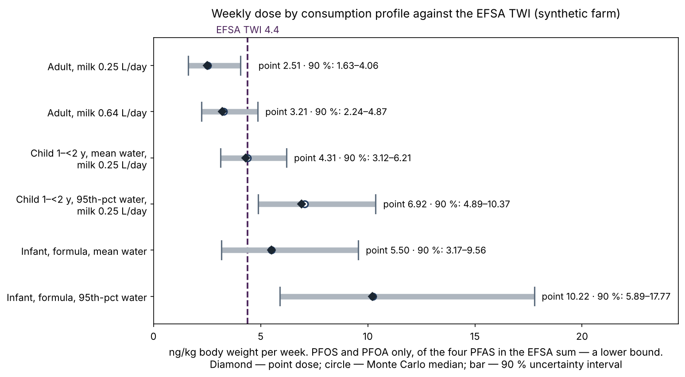

# Farm Environmental Passport（農場環境パスポート）

[English](README.md) · **日本語** · [Русский](README.ru.md)


[](https://github.com/Rigjite/farm-environmental-passport/actions/workflows/tests.yml)
[](LICENSE)
[](LICENSE-CORE)
[](LICENSE-CODE)
[](https://doi.org/10.5281/zenodo.24017216)

> この日本語版は英語版 README の翻訳です。内容に違いがある場合は英語版が優先します。

**特定の一つの農場**について、独立した環境パスポートを作成するエージェント・スキルです。農場に何が入ってきているか、何がどの方法で測定されているか、何が一度も測定されていないか、そして最初にどの試料を採るべきかを示します。最初のモジュールは PFAS スクリーニングで、同じ構成で水、栄養塩、土壌、家畜、その他の汚染物質、気候リスク、ため池、生物多様性を扱います。

> **ステータス — プレビュー版（v0.3.7）。** 本手法は、米国ニューヨーク州デラウェア郡の**架空（合成）**の酪農場で実演しています。`examples/` にある分析値はすべて架空であり、その旨を明記しています。基準値、構成、計算は実在のものです。**実在の農場での検証はまだ行っていません**。次の段階は現地パイロットです。パスポートはスクリーニングと専門的見解であり、法令適合の判定、検査機関の報告書、医学的助言ではありません。

**手法論文:** Baldanova R. (2026). *Farm Environmental Passport: a status-and-gap method for screening the environmental pathways of a single farm, with PFAS as the first module.* Methods note. Zenodo. https://doi.org/10.5281/zenodo.24017216

## 概要 — 架空の農場

120 エーカーの酪農場。4 枚の飼料畑に 3〜10 シーズンにわたりクラス B の下水汚泥（バイオソリッド）が施用され、5 枚目の畑は対照区です。最も長く施用された畑の地下水下流側に深さ 35 m の生活用井戸があります。数値はすべて架空です。

**回答カード（モジュール 1、PFAS）**

| 対象 | ステータス | 理由 |
|---|---|---|
| 下水汚泥 | 緑 | PFOS 12、PFOA 5 µg/kg — ニューヨーク州環境保全局（NYSDEC）方針 DMM-7 の最下位区分 |
| 土壌 | 緑。畑 F1 のみ黄 | F1 の PFOS 0.90 µg/kg は DEC ガイダンス値の 102 %。ただし農地の基準ではないため、最大でも黄 |
| 井戸 | 黄 | PFOS 6.5 ng/L — 連邦 MCL 4.0（遵守期限は将来）を上回り、ニューヨーク州 MCL 10 を下回る |
| 牛乳 | 緑（注記あり） | PFOS 18 ng/L — メイン州の対応レベル 210 を大きく下回るが、パスポート自身のモデルの 95 パーセンタイルに位置する。ノイズではなく、確認すべき不一致 |

**週間摂取量（PFOS + PFOA のみ、下限推定）と EFSA の耐容週間摂取量 4.4 ng/kg との比較**

| プロファイル | 点推定 | 90 % 区間 | 超過確率 |
|---|---|---|---|
| 成人、牛乳 0.64 L/日 | 3.21 | 2.24–4.87 | 11 % |
| 1〜2 歳未満の子ども、平均的な飲水量、牛乳 0.25 L/日 | 4.31 | 3.12–6.21 | 50 % |
| 井戸水で調製した粉ミルクを飲む乳児、平均摂取量 | 5.50 | 3.17–9.56 | 75 % |

1 回の採水でしか分かっていない井戸の年平均濃度が、成人と乳児の摂取量の分散の 74〜88 % を説明します。そのためパスポートの最初の推奨は**井戸の季節ごとの連続採水**です。これは採水の優先順位であり、健康に関する判断ではありません。



詳しい事例: [PFAS モジュール](examples/FARM-PFAS-SIMULATION-2026-10-31-r7.en.md) · [水と栄養塩](examples/FARM-WATER-NUTRIENTS-SIMULATION-2026-10-31-r2.en.md)（英語版。ロシア語の原文が同じフォルダにあります）。

## できること

- **基準値をデータとして扱う。** 各基準値を、単位、法的地位（施行中、将来施行、ガイダンス、目安、廃止、数値のない要件）、適用日、発行機関自身の判定ルール、最終確認日、検証マークとともに保存します。収録パック: ニューヨーク州・米国連邦、欧州連合（`core/thresholds/`）。
- **色が付くのは測定値だけ。** モデルや衛星データでしか分からないもの、まったく分からないものは**灰色**のままとし、それを解消する試料とともに欠落レジストリに登録します。赤は、施行中の基準を継続的に超過した場合に限ります（`references/status-rules.md`）。
- **4 つの必須摂取シナリオ** — 農場外の成人、農場に住む成人、井戸水で調製した粉ミルクを飲む乳児、幼児。曝露係数は ATSDR（2023）、比較基準は EFSA の耐容週間摂取量です（`references/dose-scenarios.md`）。
- **不確実性と情報価値。** モンテカルロ法による伝播と一次感度指数で、次に採るべき試料に順位を付けます（`examples/uncertainty.py`）。
- **113 項目の指標カタログ** — 農学・土壌、家畜、農場の生態系、横断的項目。「検討した」ことが「測定する」ことにならないよう、選択ルールを備えています（`core/indicators/`）。
- **NASA リモートセンシング層** — 製品、解像度、使用ルール。衛星データは現地確認の対象を絞り、トリガーを設定しますが、それだけでステータスを決めることはありません（`core/remote-sensing/nasa-layer.json`）。

## できないこと

測定は行いません。測定は認定検査機関が行い、パスポートは採取地点、深さ、季節、分析対象、分析法を指定します。法令適合の判定や健康上の結論は出さず、農場の書面による同意なしに農場のデータを公開することはありません。

## 使い方

スキルは、ルートに `SKILL.md` を置いたフォルダ（Agent Skills 形式）です。スキルに対応した AI エージェントが `SKILL.md` を読み、それに従って `scripts/` のスクリプトを呼び出します。

テストの実行（Python 3.10 以上、`numpy` と `matplotlib` が必要。テストの一つが事例の元の作図スクリプトを再実行します）:

```bash
python3 tests/run_tests.py
```

実行結果は `tests/RUN-LOG.md` に書き出されます。このバージョンの期待結果は 34/34 PASS です。同じテストがプッシュのたびに GitHub Actions で実行されます。

## 構成

| パス | 内容 |
|---|---|
| `SKILL.md` | スキル本体: 手順、ルール、品質ゲート |
| `core/` | 共通ライブラリ: 指標カタログ、基準値パック、NASA 層、Ecosystem Digital Twin カタログとの対応表 |
| `references/` | ステータスのルール、摂取シナリオ、媒体別の分析法、基準値の検証記録 |
| `scripts/` | `passport_calc.py`（摂取量、収支、ステータス）、`indicator_select.py`（選択、欠落レジストリ、採取計画、NASA への依頼）、`render_catalogue.py`、`render_thresholds.py` |
| `examples/` | 架空の農場: 現行テキストの英語版（`*.en.md`）とロシア語の原文、変更しない原本、図（`figures/en/` 英語、`figures/` ロシア語）とスクリプト。どれが現行かは `ACTIVE-TEXTS.md` に記載 |
| `tests/` | `run_tests.py`、テストの説明、直近の実行ログ |
| `archive/v0.1.0/` | 最初のバージョン（変更なし） |

## 関連

- Ecosystem Digital Twin — 生態系の「生きたモデル」を作る姉妹スキル。パスポートは、一つの農場についてのツインの入口にあたります: https://github.com/Rigjite/Ecosystem-Digital-Twin

## 著者

Rigjita Baldanova, PhD — New York, NY, USA · ORCID [0009-0009-7891-7007](https://orcid.org/0009-0009-7891-7007)

草稿作成、コード、翻訳、文献確認に大規模言語モデルの支援を受けました。すべての出典と数値は著者が確認しています。

## ライセンス

手法と文書 — CC BY 4.0。指標カタログ、基準値パック、リモートセンシング層（`core/`）— CC BY-NC 4.0。コード — Apache-2.0。全文: `LICENSE`、`LICENSE-CORE`、`LICENSE-CODE`。どの部分がどのライセンスかは `LICENSE-NOTICE.md` を参照してください。
