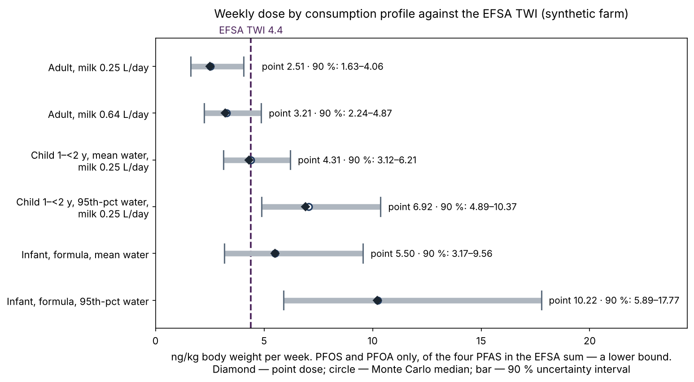

# Farm Environmental Passport

**English** · [日本語](README.ja.md) · [Русский](README.ru.md)


[](https://github.com/Rigjite/farm-environmental-passport/actions/workflows/tests.yml)
[](LICENSE)
[](LICENSE-CORE)
[](LICENSE-CODE)
[](https://doi.org/10.5281/zenodo.24023493)
[](https://doi.org/10.5281/zenodo.24017216)

An agent skill that builds an independent environmental passport for **one specific farm**: what enters the farm, what has been measured and by what method, what has never been measured, and which sample to take first. PFAS screening is the first module; the same construction covers water, nutrients, soil, livestock, other contaminants, climate risk, ponds and biodiversity.

> **Status — preview (v0.3.7).** The method is demonstrated on a **synthetic** dairy farm in Delaware County, New York. Every laboratory value in `examples/` is invented and labelled as such; the thresholds, the structure and the calculations are real. The skill has **not yet been validated on a real farm** — a field pilot is the next step. The passport is screening and expert opinion, not a compliance determination, a laboratory report or medical advice.

**Method:** Baldanova R. (2026). *Farm Environmental Passport: a status-and-gap method for screening the environmental pathways of a single farm, with PFAS as the first module.* Methods note. Zenodo. https://doi.org/10.5281/zenodo.24017216

**Skill:** Baldanova R. (2026). *Farm Environmental Passport — agent skill (preview)*, v0.3.7. Zenodo. https://doi.org/10.5281/zenodo.24023493

## Quick look — the synthetic farm

A 120-acre dairy farm that has received class B biosolids on four forage fields for 3 to 10 seasons, with a fifth field as control and a 35 m domestic well down-gradient of the oldest fields. All values are synthetic.

**Answer card (Module 1, PFAS)**

| Object | Status | Why |
|---|---|---|
| Biosolids | green | PFOS 12, PFOA 5 µg/kg — lowest tier of NYSDEC DMM-7 |
| Soil | green; field F1 yellow | F1 PFOS 0.90 µg/kg — 102 % of a DEC guidance value that is not an agricultural standard, so yellow at most |
| Well | yellow | PFOS 6.5 ng/L — above the federal MCL of 4.0 (compliance date in the future), below the New York MCL of 10 |
| Milk | green, with a flag | PFOS 18 ng/L — far below the Maine action level of 210, but at the 95th percentile of the passport's own model: a disagreement to check, not noise |

**Weekly dose, PFOS + PFOA only (a lower bound), against the EFSA tolerable weekly intake of 4.4 ng/kg**

| Profile | Point | 90 % interval | P(exceed) |
|---|---|---|---|
| Adult, milk 0.64 L/day | 3.21 | 2.24–4.87 | 11 % |
| Child 1–<2 y, mean water, milk 0.25 L/day | 4.31 | 3.12–6.21 | 50 % |
| Infant, formula prepared with well water, mean intake | 5.50 | 3.17–9.56 | 75 % |

The annual well concentration, known from one sample, explains 74–88 % of the dose variance for adults and infants, so the passport's first recommendation is **a seasonal well series** — a sampling priority, not a health statement.



Full worked examples: [PFAS module](examples/FARM-PFAS-SIMULATION-2026-10-31-r7.en.md) · [water and nutrients](examples/FARM-WATER-NUTRIENTS-SIMULATION-2026-10-31-r2.en.md) (English editions; the Russian sources sit beside them).

## What it does

- **Thresholds are data.** Every reference value is stored with its unit, legal status (in force, future, guidance, orientation, superseded, requirement), date, the issuing body's own determination rule, the date of the last check and a verification mark. Packs: New York / US federal and European Union (`core/thresholds/`).
- **Only measurements carry a colour.** Anything known only from a model, a satellite product or not at all stays **grey** and enters the gap registry with the sample that would close it. Red is reserved for a sustained exceedance of a rule in force (`references/status-rules.md`).
- **Four mandatory dose scenarios** — off-farm adult, resident adult, infant fed formula prepared with well water, young child — with exposure factors from ATSDR (2023) and the EFSA tolerable weekly intake (`references/dose-scenarios.md`).
- **Uncertainty and value of information.** Monte Carlo propagation and first-order sensitivity indices rank the next samples (`examples/uncertainty.py`).
- **Indicator catalogue** of 113 indicators — agronomy and soil, livestock, the farm ecosystem, cross-cutting items — with selection rules so that "considered" does not mean "sampled" (`core/indicators/`).
- **NASA remote-sensing layer** — products, resolutions and rules; satellite values target field checks and set triggers but never set a status alone (`core/remote-sensing/nasa-layer.json`).

## What it does not do

It does not measure: certified laboratories measure, and the passport specifies points, depth, season, analytes and methods. It does not issue compliance determinations or health conclusions, and it never publishes a farm's data without the farm's written consent.

## Use

The skill is a folder with `SKILL.md` at its root, in the Agent Skills format: an AI agent that supports skills reads `SKILL.md` and follows it, calling the scripts in `scripts/`.

Run the tests (Python 3.10+ with `numpy` and `matplotlib`; one test re-runs the original figure script of the worked example):

```bash
python3 tests/run_tests.py
```

The run writes `tests/RUN-LOG.md`. Expected result for this version: 34/34 PASS. The same suite runs on every push (GitHub Actions).

## Layout

| Path | Contents |
|---|---|
| `SKILL.md` | the skill: procedure, rules, quality gate |
| `core/` | shared library: indicator catalogue, threshold packs, NASA layer, crosswalk to the Ecosystem Digital Twin catalogue |
| `references/` | status rules, dose scenarios, methods by matrix, threshold verification record |
| `scripts/` | `passport_calc.py` (doses, balances, statuses), `indicator_select.py` (selection, gap registry, sampling plan, NASA request), `render_catalogue.py`, `render_thresholds.py` |
| `examples/` | synthetic farm: English editions (`*.en.md`) and Russian sources of the texts in force, unchanged originals, figures (`figures/en/` English, `figures/` Russian) and scripts; `ACTIVE-TEXTS.md` says which text is in force |
| `tests/` | `run_tests.py`, test descriptions, last run log |
| `archive/v0.1.0/` | the first version, unchanged |

## Related

- Ecosystem Digital Twin — the companion skill for living models of ecosystems; the passport is the twin's entry level for one farm: https://github.com/Rigjite/Ecosystem-Digital-Twin

## Author

Rigjita Baldanova, PhD — New York, NY, USA · ORCID [0009-0009-7891-7007](https://orcid.org/0009-0009-7891-7007)

Large language models assisted with drafting, code, translation and reference checks; the author verified every source and number.

## Licence

Method and documentation — CC BY 4.0; indicator catalogue, threshold packs and remote-sensing layer (`core/`) — CC BY-NC 4.0; code — Apache-2.0. Full texts: `LICENSE`, `LICENSE-CORE`, `LICENSE-CODE`; which part is under which licence: `LICENSE-NOTICE.md`.
