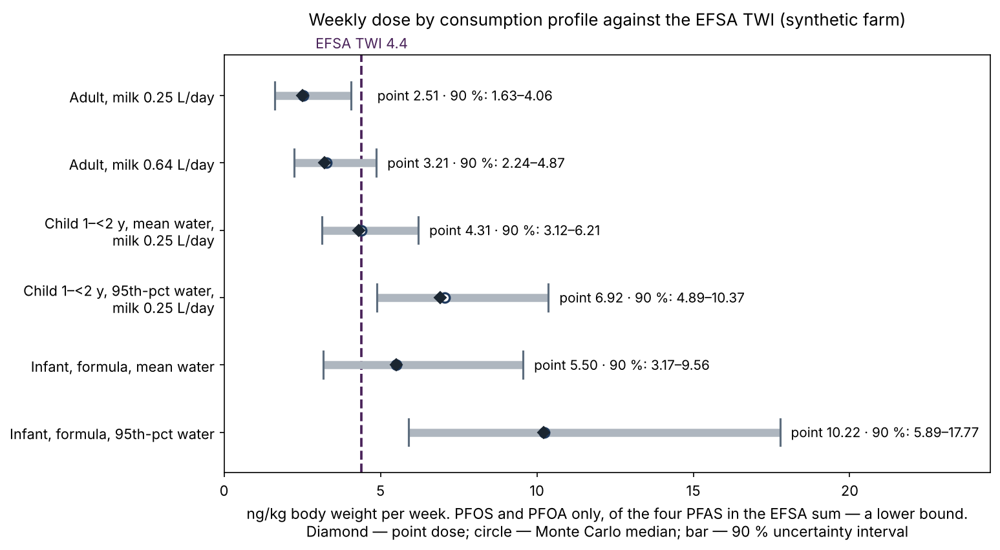

# Farm Environmental Passport (Экологический паспорт фермы)

[English](README.md) · [日本語](README.ja.md) · **Русский**


[](https://github.com/Rigjite/farm-environmental-passport/actions/workflows/tests.yml)
[](LICENSE)
[](LICENSE-CORE)
[](LICENSE-CODE)
[](https://doi.org/10.5281/zenodo.24023493)
[](https://doi.org/10.5281/zenodo.24017216)

> Русская версия — перевод английского README. При расхождении действует английский текст.

Навык для ИИ-агента, который составляет независимый экологический паспорт **одной конкретной фермы**: что поступает на ферму, что измерено и каким методом, что не измерялось ни разу и какую пробу взять первой. Первый модуль — скрининг PFAS; по той же схеме строятся вода, биогены, почва, животноводство, другие загрязнители, климатические риски, пруды и биоразнообразие.

> **Статус — предварительная версия (v0.3.7).** Метод показан на **синтетической** молочной ферме в округе Делавэр, штат Нью-Йорк. Все лабораторные значения в `examples/` вымышлены и помечены как синтетические; пороги, структура и расчёты — реальные. **На реальной ферме навык ещё не проверялся** — следующий шаг полевой пилот. Паспорт — это скрининг и экспертное мнение, а не заключение о соответствии нормам, не лабораторный отчёт и не медицинская рекомендация.

**Метод:** Baldanova R. (2026). *Farm Environmental Passport: a status-and-gap method for screening the environmental pathways of a single farm, with PFAS as the first module.* Methods note. Zenodo. https://doi.org/10.5281/zenodo.24017216

**Навык:** Baldanova R. (2026). *Farm Environmental Passport — agent skill (preview)*, v0.3.7. Zenodo. https://doi.org/10.5281/zenodo.24023493

## Коротко — синтетическая ферма

Молочная ферма площадью 120 акров: на четыре кормовых поля от 3 до 10 сезонов вносили осадок сточных вод класса B, пятое поле — контрольное, бытовая скважина глубиной 35 м расположена ниже по потоку подземных вод от самых старых полей. Все значения синтетические.

**Карточка-ответ (модуль 1, PFAS)**

| Объект | Статус | Почему |
|---|---|---|
| Осадок | зелёный | PFOS 12, PFOA 5 мкг/кг — нижний ярус политики NYSDEC DMM-7 |
| Почва | зелёный; поле F1 — жёлтый | PFOS на F1 — 0,90 мкг/кг, 102 % ориентира DEC; это не сельскохозяйственная норма, поэтому не выше жёлтого |
| Скважина | жёлтый | PFOS 6,5 нг/л — выше федерального MCL 4,0 (срок соблюдения ещё не наступил), ниже MCL штата Нью-Йорк 10 |
| Молоко | зелёный, с пометкой | PFOS 18 нг/л — намного ниже уровня действия штата Мэн 210, но на 95-м перцентиле собственной модели паспорта: расхождение, которое нужно проверить, а не шум |

**Недельная доза, только PFOS + PFOA (оценка снизу), против допустимой недельной дозы EFSA 4,4 нг/кг**

| Профиль | Точечная | 90 %-интервал | Вероятность превышения |
|---|---|---|---|
| Взрослый, молоко 0,64 л/сут | 3,21 | 2,24–4,87 | 11 % |
| Ребёнок 1–2 лет, вода — средняя норма, молоко 0,25 л/сут | 4,31 | 3,12–6,21 | 50 % |
| Младенец на смеси, приготовленной на воде скважины, средняя норма | 5,50 | 3,17–9,56 | 75 % |

Годовая концентрация в скважине, известная по одной пробе, объясняет 74–88 % дисперсии дозы у взрослых и младенцев, поэтому первая рекомендация паспорта — **сезонная серия проб скважины**. Это приоритет отбора, а не медицинское заключение.



Полные разобранные примеры на русском: [модуль PFAS](examples/FARM-PFAS-SIMULATION-2026-10-31-r7.md) · [вода и биогены](examples/FARM-WATER-NUTRIENTS-SIMULATION-2026-10-31-r2.md). Английские версии — рядом (`*.en.md`).

## Что делает навык

- **Пороги — это данные.** Каждое пороговое значение хранится с единицей измерения, правовым статусом (действует, вступит в силу, руководство, ориентир, заменён, требование без числа), датой, собственным правилом определения превышения у выпустившего органа, датой последней проверки и отметкой о сверке. Пакеты: штат Нью-Йорк и федеральный уровень США, Европейский союз (`core/thresholds/`).
- **Цвет получает только измерение.** Всё, что известно лишь из модели, спутниковых данных или не известно вовсе, остаётся **серым** и попадает в реестр пробелов вместе с пробой, которая его закроет. Красный — только при устойчивом превышении действующей нормы (`references/status-rules.md`).
- **Четыре обязательных сценария дозы** — взрослый вне фермы, взрослый житель фермы, младенец на смеси, приготовленной на воде скважины, и ребёнок раннего возраста; факторы экспозиции — ATSDR (2023), ориентир — допустимая недельная доза EFSA (`references/dose-scenarios.md`).
- **Неопределённость и ценность информации.** Метод Монте-Карло и индексы чувствительности первого порядка ранжируют следующие пробы (`examples/uncertainty.py`).
- **Каталог из 113 показателей** — агрономия и почва, животноводство, экосистема фермы, сквозные показатели — с правилами отбора, чтобы «рассмотрено» не означало «измерять» (`core/indicators/`).
- **Слой спутниковых данных NASA** — продукты, разрешение и правила; спутниковые данные направляют полевые проверки и задают триггеры, но никогда сами не определяют статус (`core/remote-sensing/nasa-layer.json`).

## Чего навык не делает

Навык ничего не измеряет: измеряют аккредитованные лаборатории, а паспорт задаёт точки, глубину, сезон, аналиты и методы. Он не выносит заключений о соответствии нормам и медицинских выводов и никогда не публикует данные фермы без её письменного согласия.

## Как пользоваться

Навык — это папка с `SKILL.md` в корне в формате Agent Skills: ИИ-агент, поддерживающий навыки, читает `SKILL.md`, следует ему и вызывает скрипты из `scripts/`.

Запуск тестов (Python 3.10+ с `numpy` и `matplotlib`; один из тестов перезапускает исходный скрипт рисунков примера):

```bash
python3 tests/run_tests.py
```

Результат записывается в `tests/RUN-LOG.md`. Ожидаемый результат для этой версии — 34/34 PASS. Те же тесты запускаются при каждой загрузке изменений (GitHub Actions).

## Структура

| Путь | Содержание |
|---|---|
| `SKILL.md` | сам навык: порядок работы, правила, контроль качества |
| `core/` | общая библиотека: каталог показателей, пакеты порогов, слой NASA, соответствие каталогу Ecosystem Digital Twin |
| `references/` | правила статусов, сценарии доз, методы по средам, протокол сверки порогов |
| `scripts/` | `passport_calc.py` (дозы, балансы, статусы), `indicator_select.py` (отбор показателей, реестр пробелов, план проб, запрос к NASA), `render_catalogue.py`, `render_thresholds.py` |
| `examples/` | синтетическая ферма: действующие тексты на английском (`*.en.md`) и в русском оригинале, неизменённые исходные тексты, рисунки (`figures/en/` — английские, `figures/` — русские) и скрипты; какой текст действует — в `ACTIVE-TEXTS.md` |
| `tests/` | `run_tests.py`, описания тестов, протокол последнего запуска |
| `archive/v0.1.0/` | первая версия без изменений |

## Связанный навык

- Ecosystem Digital Twin — парный навык для «живых» моделей экосистем; паспорт — входной уровень двойника для одной фермы: https://github.com/Rigjite/Ecosystem-Digital-Twin

## Автор

Rigjita Baldanova, PhD — New York, NY, USA · ORCID [0009-0009-7891-7007](https://orcid.org/0009-0009-7891-7007)

Большие языковые модели помогали с черновиками, кодом, переводом и проверкой ссылок; каждый источник и каждое число проверены автором.

## Лицензия

Метод и документация — CC BY 4.0; каталог показателей, пакеты порогов и слой спутниковых данных (`core/`) — CC BY-NC 4.0; код — Apache-2.0. Полные тексты: `LICENSE`, `LICENSE-CORE`, `LICENSE-CODE`; какая часть под какой лицензией — `LICENSE-NOTICE.md`.
