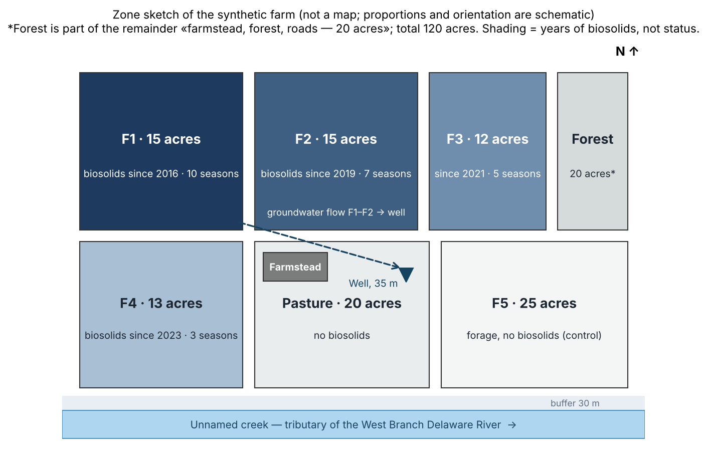
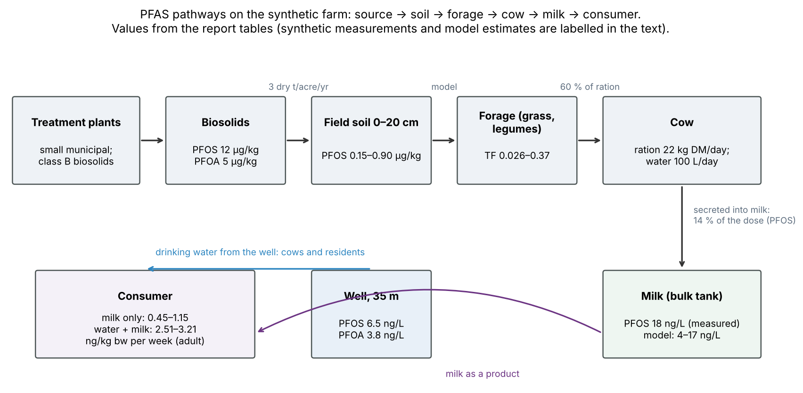
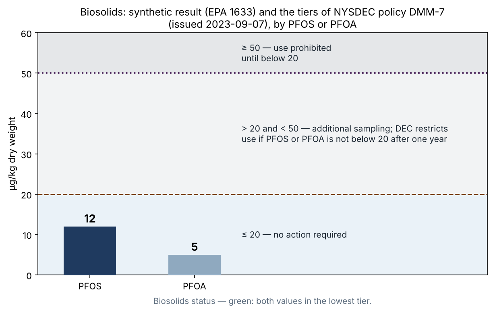
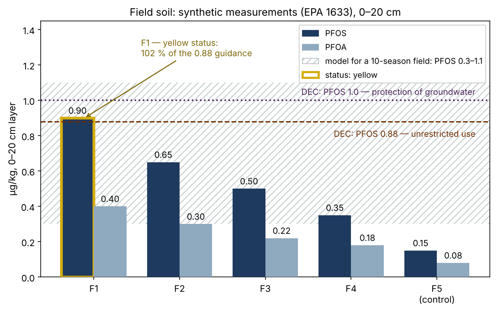
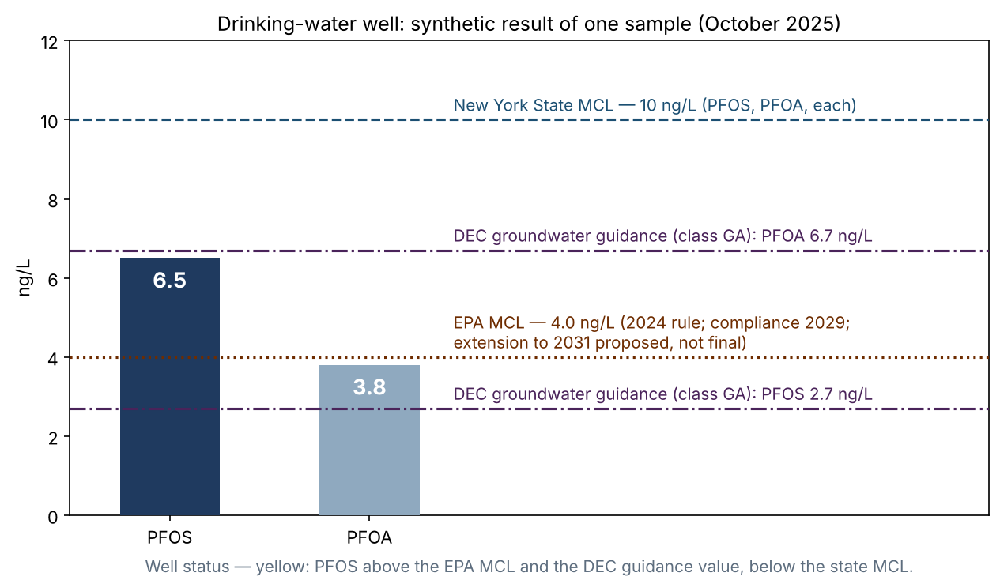
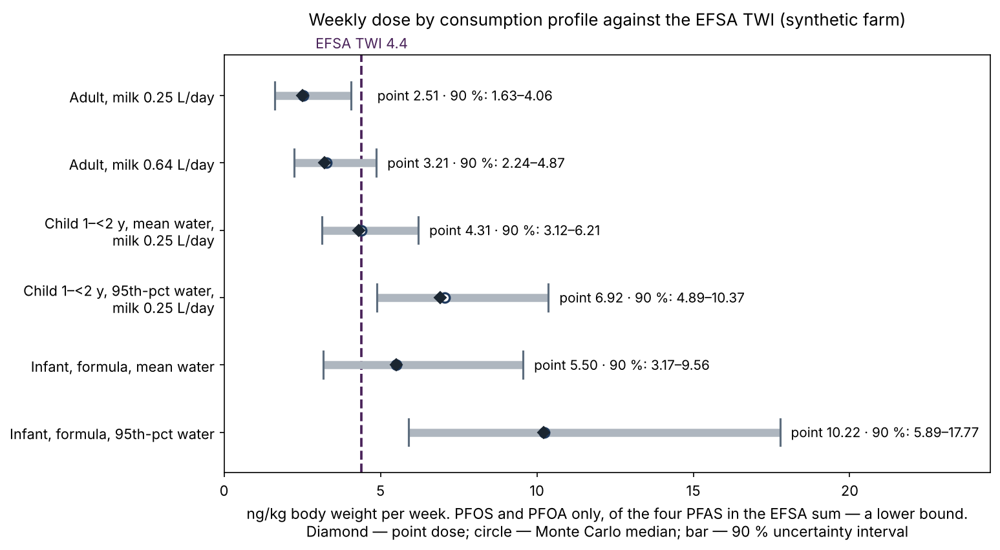
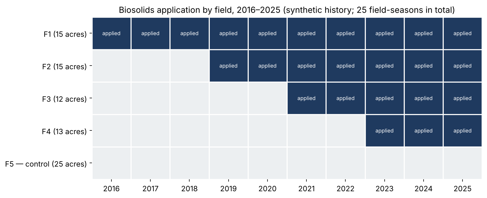

# PFAS screening of a farm: a synthetic "farm → product → dose" example

**SYNTHETIC EXAMPLE (simulation).** The farm, its history and every laboratory value are invented and labelled as synthetic. Real: the state, federal and European thresholds and guidance values, the structure of the passport and the logic of the calculation. Date: 2026-10-31. Prepared on the "PFAS screening of a farm" template.

**English edition of redaction 7 (2026-11-06).** The Russian text (`FARM-PFAS-SIMULATION-2026-10-31-r7.md`) is the source; numbers, statuses and conclusions are identical. Redaction 7: the infant and young-child profiles were checked against the primary source, ATSDR (2023), and taken from it directly; the child rows and the infant 95th-percentile row in §4.1 were recalculated; the conclusions did not change. Earlier redactions added the DMM-7 tiers checked against the DEC primary (issued 2023-09-07), the uncertainty and sensitivity block (§4.1), the sampling plan ordered by value of information, the calculation chain of the milk model and the DEC guidance values. **Synthetic values have never been changed.** The revision history is summarised at the end; calculation scripts: `uncertainty.py` and `reconstruct.py`.

## Summary
A synthetic 120-acre dairy farm in Delaware County, New York (Catskill/Delaware watershed), has received biosolids from small municipal treatment plants on its forage fields for ten years. Screening of open data and synthetic laboratory results gives:
- **biosolids** — the lowest tier of NYSDEC policy DMM-7 (≤ 20 µg/kg for PFOS and for PFOA); no further action required;
- **field soil** — a gradient that follows years of application; field F1 (PFOS 0.90 µg/kg) is slightly above the DEC guidance value for unrestricted-use soils (0.88), the other fields are below it; all fields are below the rural-soil background that DEC proposes to adopt (3.0 µg/kg);
- **well** — PFOS above the federal MCL (4.0 ng/L) and the DEC groundwater guidance value (2.7 ng/L), below the state MCL (10 ng/L); status yellow;
- **milk** — trace levels; the synthetic measurement (18 ng/L) sits at the 95th percentile of the model — a signal to check, not noise.

**Dose** (point values for two PFAS — PFOS and PFOA — of the four in the EFSA reference of 4.4 ng/kg per week): resident adult 2.51–3.21; infant fed formula prepared with well water 5.50–10.22 from water alone. **With uncertainty (§4.1):** for an adult an exceedance is unlikely for two PFAS (3–11 %) but possible if the missing PFNA and PFHxS add up to half again (13–38 %); for an infant at the mean drinking rate an exceedance is likely (about 75 %; 66–89 % depending on the assumption about well variability), and at the 95th percentile practically certain (above 99 %). The main source of uncertainty for adults and infants is the annual well concentration, known from one sample; for the child aged 1–2 years it is milk. The well lies down-gradient of fields F1–F2 and supplies PFAS to both people and cows: it is the first object of repeat monitoring. The screening makes no medical conclusions.

## 1. Farm profile (synthetic)
- Area 120 acres: fields F1–F4 (55 acres, forage), pasture (20 acres, no biosolids), field F5 (25 acres, forage, no biosolids — control), forest, farmstead and roads (20 acres).
- Herd: dairy; ration 22 kg dry matter per cow per day, 60 % of it forage from the farm's own fields; water intake 100 L/day from the same well.
- Class B biosolids from small municipal plants: 3 dry tons per acre per year; F1 since 2016 (10 seasons), F2 since 2019 (7), F3 since 2021 (5), F4 since 2023 (3); 25 field-seasons in total.
- Water: a 35 m well at the farmstead; groundwater flows from fields F1–F2 towards the well. A creek runs along the southern boundary with a 30 m buffer.

## 2. Pathways

Screening chain: treatment plants → biosolids → field soil → forage → cow → milk → consumer; in parallel, the well as a drinking source for livestock and residents. Transfer from soil to forage is described by the range of the transfer factor TF 0.026–0.37 (mean PFOS values measured in mixed grasses and legumes on biosolid-amended fields; Simones et al. 2024, doi:10.1021/acs.jafc.4c02078), applied as a range, not a point value. The fraction of the PFOS dose secreted into milk is taken as 14 % (Kowalczyk et al. 2013, doi:10.1021/jf304680j: 14 ± 3.6 % in a dairy-cow feeding study). Both values are literature assumptions with primary sources.

**Calculation chain of the milk model (reconstructed 2026-11-05; reproduces the published 4–17 ng/L):** PFOS in milk = (mean soil of fields F1–F4, 0.60 µg/kg × TF × own forage 13.2 kg dry matter per day + cow water 100 L/day × well PFOS 6.5 ng/L) × 14 % ÷ milk yield 28.8 kg/day. At TF 0.026 this gives 4.2 ng/L, at TF 0.37 17.4 ng/L. Water from the well contributes a large share of PFOS in milk: 18 to 77 % (median 46 %, §4.1). Purchased feed (40 % of the ration) is assumed free of PFAS — a model assumption (gap 8).

## 3. Results by medium

### 3.1. Biosolids (synthetic measurement, EPA Method 1633)
PFOS 12 µg/kg dry weight, PFOA 5 µg/kg. NYSDEC policy DMM-7 sets tiers by PFOS **or** PFOA: ≤ 20 µg/kg — no action required; above 20 and below 50 µg/kg — additional sampling, and if PFOS or PFOA is not below 20 after one year, DEC restricts use of the biosolids; ≥ 50 µg/kg — DEC prohibits use until the concentration is below 20 (DMM-7, issued 2023-09-07, primary source). Both values are in the lowest tier. For class B biosolids, control follows DMM-7 (sampling at the source); DMM-7A covers biosolids products. Status: **green** — under DMM-7 application is permissible with continued monitoring (for the decision on fields F1–F2 see §7).

### 3.2. Field soil, 0–20 cm (synthetic measurements, EPA 1633)
| Field | Seasons of application | PFOS, µg/kg | PFOA, µg/kg | PFOS vs guidance 0.88 |
|---|---|---|---|---|
| F1 | 10 | 0.90 | 0.40 | 102 % |
| F2 | 7 | 0.65 | 0.30 | 74 % |
| F3 | 5 | 0.50 | 0.22 | 57 % |
| F4 | 3 | 0.35 | 0.18 | 40 % |
| F5 (control) | 0 | 0.15 | 0.08 | 17 % |

The gradient follows years of application monotonically; the control field shows the background level. The accumulation model for a field with 10 seasons gives PFOS 0.3–1.1 µg/kg; the measured F1 value (0.90) lies inside the range — model and synthetic measurement agree (this demonstrates the logic of the passport, not the accuracy of the model).

**Guidance values.** Neither New York State nor the EU has adopted PFAS standards for agricultural soils. DEC has guidance values for its remedial programs (Part 375), in force until soil cleanup objectives are adopted (DEC guidance, April 2023; primary source opened 2026-11-05):
- unrestricted use — PFOA 0.66, PFOS 0.88 µg/kg;
- protection of groundwater — PFOA 0.8, PFOS 1.0 µg/kg (since 2023-03-28; earlier values 1.1 and 3.7 replaced).

These are guidance values for remedial sites, not standards for farmland; the passport uses them as orientation, and the status they set never rises above yellow. F1 PFOS is 102 % of the unrestricted-use value and 90 % of the groundwater-protection value; the other fields, and PFOA on all fields, are below both. Context: DEC postponed the standards until a study of rural soil background is complete and, according to a secondary source, proposes a background of PFOS 3.0 and PFOA 1.5 µg/kg; all fields are below these values, so the exceedance of the guidance value on F1 lies within the proposed background.

Values below 0.5 µg/kg (F3–F5, and PFOA on all fields) are at the lower limit that DEC accepts as a laboratory reporting limit (no higher than 0.5); in a real sample such values may come back as "below the reporting limit" or estimated — the passport treats them as censored.

Status: **green for soil overall; F1 — yellow against the guidance value** (the field with the longest history of application, up-gradient of the well).

### 3.3. Drinking-water well (synthetic sample, October 2025)
PFOS 6.5 ng/L, PFOA 3.8 ng/L.
- **New York State MCL** — 10 ng/L each (adopted 2020-08-26): not exceeded.
- **Federal EPA MCL** — 4.0 ng/L each; under the 2024 rule compliance is due in 2029; in May 2026 EPA proposed a path to extend it to 2031 — a proposal, not a final rule (check the status in the Federal Register). Compliance is assessed on a running annual average. PFOS in this single sample is above 4.0.
- **DEC groundwater guidance (human health)** — PFOA 6.7, PFOS 2.7 ng/L (DEC guidance, April 2023; primary source): PFOS above (241 %), PFOA below (57 %).
- **EU:** the sum of PFOS and PFOA (10.3 ng/L) is above the future EU groundwater standard of 4.4 ng/L for the sum of four PFAS (Directive 2026/805, applies from 2027-12-22; value from a secondary source).

MCLs apply to public water systems; a private well is not formally subject to them — the comparison is given as orientation. Status: **yellow** — screening of one sample, not a compliance determination; a seasonal series is needed (see the gap registry).

### 3.4. Milk, bulk tank (synthetic measurement)
PFOS 18 ng/L. The soil → forage → cow model (§2) gives 4–17 ng/L at the extreme TF values; with the uncertainty of all its parameters, the 18 ng/L measurement sits at the 95th percentile of the model (the probability that the model gives 18 or more is about 5 %, §4.1). The discrepancy is a signal, not noise: either soil-to-forage transfer on this farm is at the top of the literature range, or the milk secretion fraction is above 14 %, or there is an unaccounted source (purchased feed is assumed free of PFAS). The main uncertainty of the model is TF (58 % of variance), followed by the secretion fraction (25 %); a feed sample from F1 and F5 narrows it most. The Maine action level for PFOS in cow's milk is 210 ng/L (Maine CDC, 2017; checked against the primary source): the synthetic value is an order of magnitude lower. Under the EU pack: the EU has no binding maximum for milk; the indicative level of Recommendation 2022/1431 for PFOS is 0.020 µg/kg; 18 ng/L ≈ 87 % of that level (skill status "watch"; value from a secondary source). PFOA, PFNA and PFHxS were not measured in milk. Status: **green**, with a note on the model discrepancy and a watch against the EU indicative level.

## 4. Product → dose scenario
Assumptions (all labelled): adult — body weight 70 kg, milk intake 0.25–0.64 L/day, well water 2 L/day. Infant and child aged 1–2 years — body weight and water intake from ATSDR (2023), based on the EPA Exposure Factors Handbook (2019), mean and 95th percentile. Only PFOS and PFOA enter the calculation; PFNA and PFHxS were not measured (gap registry), so **every point dose below is a lower bound** for the sum of the four PFAS in the EFSA reference. In milk only PFOS is counted, in water PFOS and PFOA.

- Milk only (off-farm adult consumer): 18 ng/L × 1.75–4.5 L/week = 31–81 ng/week ÷ 70 kg = **0.45–1.15 ng/kg/week**.
- Well water (resident adult): (6.5 + 3.8) ng/L × 14 L/week = 144 ng/week ÷ 70 kg = **2.06 ng/kg/week**.
- Milk + water (resident adult): **2.51–3.21 ng/kg/week** — 57–73 % of the EFSA TWI of 4.4 ng/kg/week.
- **Infant fed formula prepared with well water (water only): 5.50 ng/kg/week at the mean intake and 10.22 at the 95th percentile, i.e. 125 % and 232 % of the TWI.**
- **Child aged 1–2 years:** with the well water, the TWI is used up at a farm-milk intake of about 0.26 L/day (mean water intake) and about 0.02 L/day (95th-percentile water). The source used gives no reference value for children's milk intake, so a break-even threshold is given instead of one dose.

Point conclusion of the scenario: for an adult the reference is not exceeded; for an infant fed formula prepared with well water it is exceeded by water alone; for a child aged 1–2 years, at moderate milk intake. In every profile drinking water, not milk, dominates, and this is a lower bound. How robust these conclusions are — §4.1. The screening makes no medical conclusion: decisions about water for infant feeding belong to the family and the health authority.

### 4.1. Uncertainty and sensitivity

**Why.** The point doses above rest on one well sample and one milk sample, and two of the four PFAS were not measured. This block shows how robust the conclusions are, which input moves the dose most and which sample to take first.

**Method.** Two kinds of spread are separated. *Variability* — differences between people (body weight, how much they drink and eat) — is kept as fixed consumption profiles. *Uncertainty* — what we do not know about the farm and what samples narrow — is propagated by Monte Carlo (400,000 draws, fixed random seed). Each input's share of the dose variance is a first-order sensitivity index: how much, on average, the spread of the dose would shrink if that input were known exactly.

**Assumptions of the analysis (all are assumptions of the skill, not measurements):**
| Input | Distribution | Basis |
|---|---|---|
| Annual well concentration relative to one sample (PFOS and PFOA together) | log-normal, median 1, GSD 1.4 (coefficient of variation about 34 %); robustness check — GSD 1.2 and 1.7 | one sample; seasonal and analytical spread |
| PFNA + PFHxS in water | 0–50 % of PFOS + PFOA, uniform | illustrative: not measured |
| Annual milk concentration relative to one sample | log-normal, GSD 1.3 | one bulk-tank sample |
| PFOA, PFNA, PFHxS in milk | 0–50 % of PFOS, uniform | illustrative: not measured |
| TF soil → forage | log-uniform, 0.026–0.37 | Simones et al. 2024 |
| PFOS secretion fraction into milk | uniform, 7–21 % (14 % ± half) | Kowalczyk et al. 2013 |
| Mean soil of fields F1–F4 | log-normal, median 0.60 µg/kg, GSD 1.2 | four measurements |

Profile parameters were checked on 2026-11-06 against the primary source — ATSDR, Exposure Dose Guidance for Water Ingestion, V1, 2023-01-31, Table 1 (EPA Exposure Factors Handbook 2019, ch. 3; community water, direct and indirect consumption; mean — CTE, 95th percentile — RME): infant under 1 year — 595 and 1,106 mL/day at a body weight of 7.8 kg, i.e. 76 and 142 mL/kg/day — identical to the earlier values; child aged 1–2 years — 245 and 658 mL/day at 11.4 kg (earlier reconstructed as 0.24 and 0.66 L/day; difference below 2 %; the child rows were recalculated from the primary source, conclusions unchanged). The adult profile (2 L/day, 70 kg) is the earlier ATSDR default (2005); the ATSDR 2023 guidance updates it: 1,313 mL/day mean and 3,229 mL/day at the 95th percentile at 80 kg, i.e. 16 and 40 mL/kg/day, and the 29 mL/kg/day used here lies between them. Sensitivity: with the ATSDR 2023 values the resident adult's dose for two PFAS ranges from 1.58 (mean water, milk 0.25 L/day) to 3.92 ng/kg/week (95th percentile, milk 0.64 L/day; 89 % of the TWI) — the adult conclusion does not change. New cards take the adult profile from ATSDR 2023.

**Results — dose, ng/kg body weight per week (TWI 4.4):**
| Profile | Point | Median | 90 % interval | P(> TWI), 2 PFAS | P(> TWI), with PFNA/PFHxS |
|---|---|---|---|---|---|
| Adult, milk 0.25 L/day | 2.51 | 2.53 | 1.63–4.06 | 3 % | 13 % |
| Adult, milk 0.64 L/day | 3.21 | 3.27 | 2.24–4.87 | 11 % | 38 % |
| Infant, water — mean | 5.50 | 5.51 | 3.17–9.56 | 75 % | 89 % |
| Infant, water — 95th percentile | 10.22 | 10.24 | 5.89–17.77 | 99 % | above 99 % |
| Child 1–2 y, mean water, milk 0.25 L/day | 4.31 | 4.40 | 3.12–6.21 | 50 % | 83 % |
| Child 1–2 y, P95 water, milk 0.25 L/day | 6.92 | 7.05 | 4.89–10.37 | 98 % | above 99 % |

**Robustness to the main assumption (well variability, two PFAS):** infant at the mean rate — 89 / 75 / 66 % at GSD 1.2 / 1.4 / 1.7; adult with milk 0.64 L/day — 2 / 11 / 21 %. The direction of the conclusions does not change under any assumption. Monte Carlo error: changing the random seed moves the probabilities by less than 0.5 percentage points.

**What moves the dose most (share of variance, with PFNA/PFHxS):**
| Profile | Well | PFNA/PFHxS in water | Milk | Other PFAS in milk |
|---|---|---|---|---|
| Adult, milk 0.64 L/day | 74 % | 8 % | 13 % | 3 % |
| Infant, water — mean | 88 % | 10 % | 0 % | 0 % |
| Child 1–2 y, mean water | 30 % | 3 % | 54 % | 10 % |

**Milk model:** median 7.2 ng/L, 90 % interval 2.9–18.3; the probability of 18 or more is about 5 %. Share of variance: TF 58 %, milk secretion fraction 25 %, well 6 %, soil 4 %. Cow water from the well accounts for 18–77 % of PFOS in milk (median 46 %).

**Value of a sample, using the well as an example.** A quarterly series of four samples narrows the uncertainty of the annual concentration (GSD from 1.4 to about 1.18). At the same mean concentration the infant's 90 % dose interval narrows from 3.17–9.56 to 4.17–7.25 ng/kg/week, the child's (1–2 years) from 3.12–6.21 to 3.27–5.89.

**Conclusions of the block.**
1. For an infant, exceeding the reference is a likely but not certain conclusion at the mean drinking rate, and practically certain at the 95th percentile.
2. For an adult, "no exceedance" is robust only for two PFAS; if PFNA and PFHxS are substantial, a high milk consumer may exceed the reference.
3. For a child aged 1–2 years at the mean drinking rate — even odds for two PFAS and a likely exceedance once the missing PFAS are included.
4. One point — the well — governs both the drinking-water dose of people and almost half of the PFOS in milk.

**Limits of the block.** All distributions are assumptions of the skill, set before the calculation and named above; the results show how the method ranks samples, not the state of a real farm. The block makes no medical conclusions. The script with a fixed seed reproduces every number of this section.

## 5. Gap registry
1. PFNA and PFHxS were not measured in any medium — the four-PFAS sum of the EFSA reference is incomplete; the dose is underestimated by an unknown amount.
2. The well is represented by one October sample; seasonal dynamics (spring high water, summer low) are unknown.
3. Feed was not sampled directly: the soil → forage block is a model over the literature TF range, not a measurement.
4. Milk of individual animals and milk by season were not measured; there is only one bulk-tank sample on one date.
5. Depth of penetration in soil (20–40 cm) and groundwater below the well were not investigated.
6. There are no data on removal with the harvest or runoff to the creek; the 30 m buffer is taken from the farm's design, not from a measurement.
7. The contribution of fields F1–F2 to the well contamination is not confirmed: a groundwater sample up-gradient of the fields (background point) is needed — without it the link "fields → well" remains a hypothesis based on flow direction.
8. Purchased feed (40 % of the ration) is assumed free of PFAS; if it is not, the milk model is underestimated — one candidate explanation of the 18 versus 4–17 ng/L discrepancy.

## 6. Sampling plan — by value of information (§4.1)
1. **Well — on the first visit.** PFNA and PFHxS in the same sample (no new field trip); a quarterly series for one year; one groundwater background point up-gradient of the fields. Closes gaps 1, 2 and 7; the well accounts for 74–88 % of the dose variance for adults and infants — its series narrows the interval most and also refines the cows' water. Method: EPA 533 or 537.1.
2. **Milk — on the same visit.** Repeat bulk-tank sample with PFOA, PFNA and PFHxS. The main input for the child aged 1–2 years (54 + 10 % of variance). Method: FDA C-010.03.
3. **Feed from F1 and F5 — in the harvest season, plus one sample of purchased feed.** Fixes TF on this farm (58 % of the milk-model variance) and checks gap 8. Method: FDA C-010.03.
4. **Soil — do not resample** until items 1–3 are back: it has little influence on the dose and the milk model (4 %). Depth 20–40 cm — depending on the background point (gap 5).

Laboratory: state-accredited for the relevant method; reporting limit for soil no higher than 0.5 µg/kg, for water no higher than 2 ng/L (DEC requirement). Biosolids, soil, surface water and groundwater (non-drinking) — EPA 1633.

## 7. Farm passport (answer card)
- Biosolids: green (lowest DMM-7 tier). Soil: green; F1 — yellow against the DEC guidance value (102 %, within the proposed background). Well water: yellow (PFOS above the EPA MCL and the DEC groundwater guidance value). Milk: green, with a note on the model discrepancy (95th percentile of the model) and a watch against the EU indicative level.
- Dose (point — lower bound for 2 of 4 PFAS; in brackets the probability of exceeding the TWI with uncertainty, two PFAS / with PFNA and PFHxS): adult — 57–73 % of the TWI (3–11 % / 13–38 %); infant fed formula with well water — 125–232 % of the TWI from water alone (75–99 % / 89 % or more); child aged 1–2 years — exceedance at a farm-milk intake from about 0.26 L/day (50–98 % / 83 % or more). The main contribution and the main uncertainty are the well water; for the child aged 1–2 years, milk.
- Recommendations: under DMM-7 the biosolids are acceptable. But the well is the main contributor to the dose and lies down-gradient of F1–F2, and F1 is above the DEC guidance value; therefore decide on continued application to F1–F2 after the seasonal well series, the PFNA/PFHxS analysis and the groundwater background point (gaps 1, 2, 7). Do not extend application to new fields until these gaps are closed. Order of sampling — §6. Inform the family of the well-water result for infant feeding — the decision belongs to the family and the health authority.
- Provenance of numbers: thresholds and guidance values — regulatory documents of the state (DOH, DEC), EPA and the EU; dose reference — EFSA (2020); checked on 2026-11-01 and 2026-11-05 (DEC guidance, April 2023); rows from secondary sources are marked; laboratory values are synthetic and labelled; transfer coefficients — literature with primary sources (Simones et al. 2024; Kowalczyk et al. 2013); child profiles — ATSDR (2023); uncertainty distributions — assumptions of the skill (§4.1).

## 8. Limits of the example
The simulation demonstrates the product and its logic, not the state of a real farm. Agreement between the model and synthetic "measurements" shows that the method works but does not prove the model accurate. The uncertainty distributions in §4.1 are assumptions, not measurements: they show how the skill ranks samples. The screening is not an official determination of compliance and makes no medical forecasts; personal exposure is established by serum testing. Thresholds were checked on 2026-11-01 and 2026-11-05; re-check by 2027-05-03, after EPA's final decision on the compliance extension, or after DEC adopts soil cleanup objectives for PFOA and PFOS. State on 2026-11-06: illustration photographs are not part of the public package; child profiles checked against ATSDR 2023; figures rebuilt. Open: threshold rows checked against secondary sources are marked verified-secondary in the pack and are used only with that mark until the primary source is read.

---

## Revision history (summary; the full register with "was / now" rows is in the Russian source)
| Redaction | Date | Main changes |
|---|---|---|
| 2 | 2026-11-05 | Infant and young-child profiles added; "lower bound, 2 of 4 PFAS"; DMM-7 tiers (not DMM-7A) for class B biosolids; laboratory methods by matrix; EPA MCL compliance date and the proposed extension; EU view |
| 3 | 2026-11-05 | DEC Part 375 soil and groundwater guidance values (primary source); F1 yellow against guidance; proposed rural-soil background marked as a proposal; background groundwater point (gap 7); DEC reporting limits |
| 4 | 2026-11-05 | Uncertainty and sensitivity block (§4.1); calculation chain of the milk model; sampling plan by value of information; gap 8 (purchased feed) |
| 5 | 2026-11-05 | DMM-7 tiers verbatim from the primary; figures rebuilt with neutral series colours |
| 6 | 2026-11-05 | Figure paths inside the package; wording on the first-order index |
| 7 | 2026-11-06 | Infant and child profiles checked against ATSDR (2023), Table 1; child rows recalculated; adult sensitivity with ATSDR 2023 (1.58–3.92); primary sources for TF (Simones et al. 2024) and the milk secretion fraction (Kowalczyk et al. 2013) |

**Figures** (`figures/en/`, built by `make_figs_en.py`): series colours are neutral; red, yellow and green in the passport mean status only, and status is shown by outline and caption.
