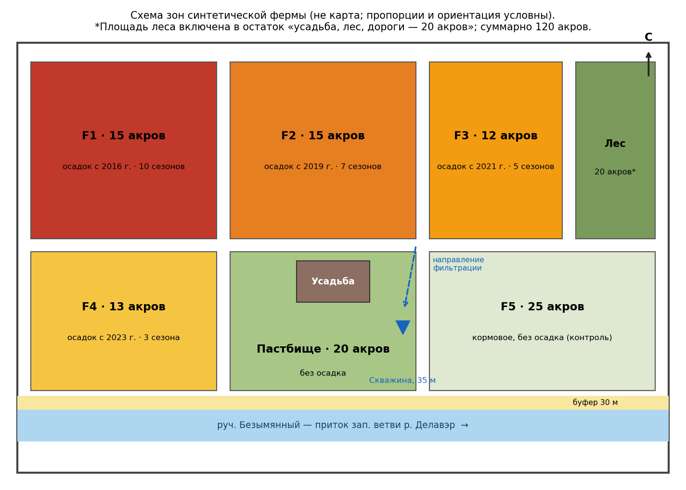
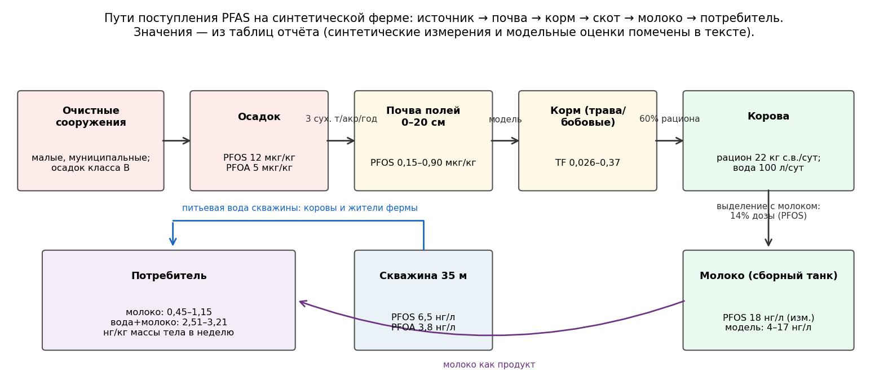
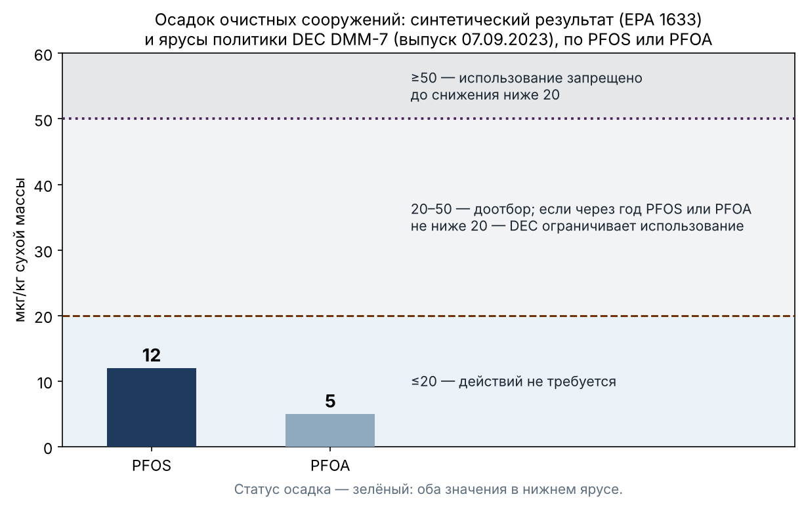
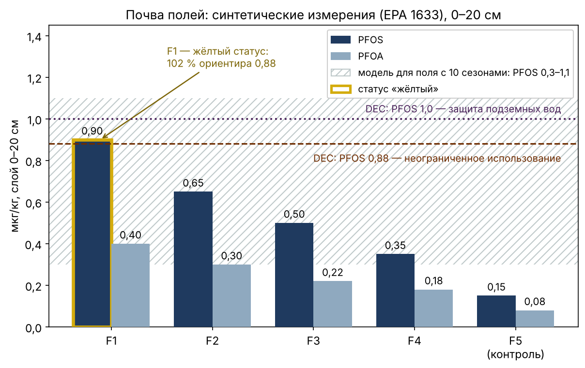
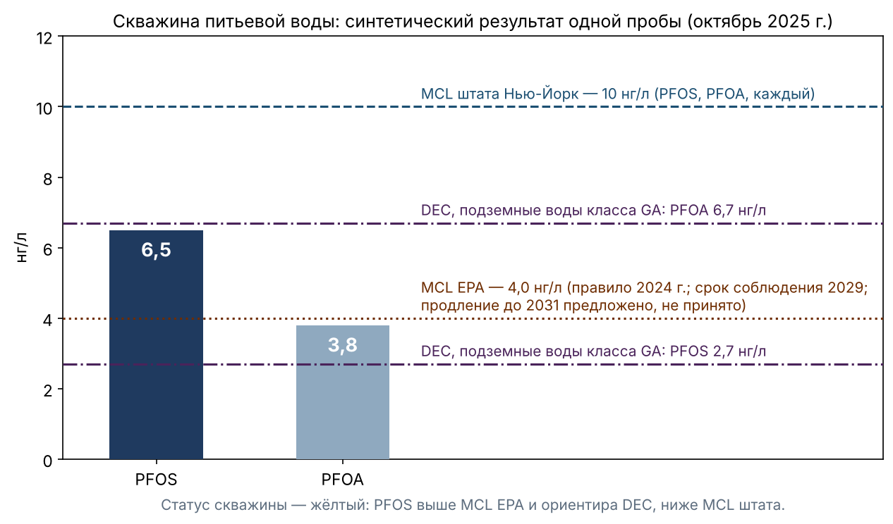
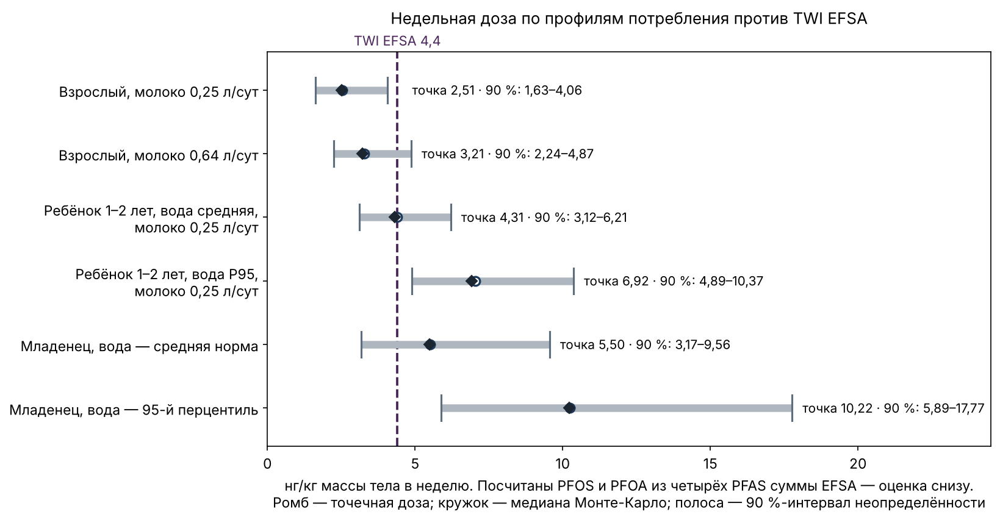
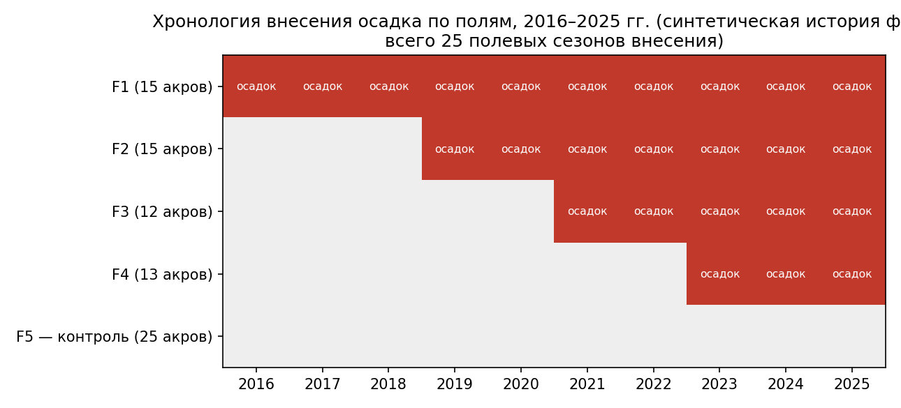

# Скрининг фермы по PFAS: синтетический пример «ферма → продукт → доза»

**СИНТЕТИЧЕСКИЙ ПРИМЕР (симуляция).** Ферма, её история и все лабораторные значения вымышлены и помечены как синтетические. Реальны: пороги и ориентиры штата, федеральные и европейские, структура паспорта и логика расчёта. Дата: 31.10.2026. Статус: черновик для кейса «Прототип»; публикация — по отдельному решению автора. Подготовлено по шаблону «Скрининг фермы по PFAS» (FARM-PFAS-SCREENING-DRAFT-2026-10-31).

**Редакция 7 от 06.11.2026** (сверка с ATSDR, 06.11.2026): параметры профилей младенца и ребёнка 1–2 лет сверены с первоисточником ATSDR (2023) и взяты из него напрямую; строки ребёнка и младенца (95-й перцентиль) в §4.1 пересчитаны; выводы не изменились. Ниже — описание редакции 6.

**Редакция 6 от 05.11.2026** (по рецензии пакета v0.3.2): пути фигур приведены к папке пакета (схема зон, пути поступления и хронология вложены в пакет; фотографии-иллюстрации помечены как файлы вне пакета); в §4.1 — честная пометка о несверенности параметров детских профилей с первоисточником ATSDR 2023; пояснение реестра №25 уточнено. Основа — редакция 5 (ярусы DMM-7 по первоисточнику DEC, выпуск 07.09.2023), редакция 4 (блок неопределённости и чувствительности §4.1, план проб по ценности информации, расчётная цепочка модели молока), редакция 3 (ориентиры DEC, A10) и редакция 2 (правки Р2). **Синтетические значения не изменены.** Исходная редакция 31.10 и редакции 2–5 сохраняются. Реестр правок — в конце документа; скрипты расчёта — «uncertainty.py» и «reconstruct.py» в пакете навыка (examples/). Английская версия этого текста — FARM-PFAS-SIMULATION-2026-10-31-r7.en.md.

## Резюме
Синтетическая молочная ферма округа Делавэр (штат Нью-Йорк, водосбор Катскилл/Делавэр) площадью 120 акров десять лет получает осадок малых муниципальных очистных сооружений на кормовые поля. Скрининг по открытым данным и синтетическим лабораторным результатам даёт:
- **осадок** — нижний ярус политики DEC DMM-7 (≤20 мкг/кг по PFOS и по PFOA), дополнительных действий не требуется;
- **почва полей** — градиент по длительности внесения; поле F1 (PFOS 0,90 мкг/кг) немного выше ориентира DEC для почв неограниченного использования (0,88), остальные поля ниже; все поля ниже фона сельских почв, который DEC предлагает принять (3,0 мкг/кг);
- **скважина** — PFOS выше федерального MCL (4,0 нг/л) и ориентира DEC для подземных вод (2,7 нг/л), ниже штатного MCL (10 нг/л); статус жёлтый;
- **молоко** — следовые уровни; синтетическое измерение (18 нг/л) лежит на 95-м перцентиле модели — это сигнал для проверки, а не шум.

**Доза** (точечные значения по двум PFAS — PFOS и PFOA — из четырёх, входящих в ориентир EFSA 4,4 нг/кг в неделю): взрослый житель — 2,51–3,21; младенец на смеси, приготовленной на воде скважины, — 5,50–10,22 только от воды. **С учётом неопределённости (§4.1):** для взрослого превышение маловероятно по двум PFAS (3–11 %), но возможно, если недостающие PFNA и PFHxS добавляют до половины (13–38 %); для младенца при средней норме питья превышение вероятно (около 75 %; 66–89 % в зависимости от допущения о разбросе скважины), при 95-м перцентиле — практически наверняка (более 99 %). Главный источник неопределённости для взрослых и младенцев — годовая концентрация в скважине, известная по одной пробе; для ребёнка 1–2 лет — молоко. Скважина лежит ниже по фильтрации от полей F1–F2 и даёт PFAS и людям, и коровам: это первый объект повторного контроля. Медицинских выводов скрининг не делает.

## 1. Профиль фермы (синтетический)
- Площадь 120 акров: поля F1–F4 (55 акров, кормовые), пастбище (20 акров, без осадка), поле F5 (25 акров, кормовое, без осадка — контроль), лес, усадьба и дороги (20 акров).
- Стадо: молочное, рацион коровы 22 кг сухого вещества в сутки, из них 60% — корм собственных полей; потребление воды 100 л/сутки из той же скважины.
- Осадок класса B малых муниципальных очистных: 3 сухие тонны на акр в год; F1 — с 2016 года (10 сезонов), F2 — с 2019 (7), F3 — с 2021 (5), F4 — с 2023 (3); всего 25 полевых сезонов внесения.
- Вода: скважина глубиной 35 м у усадьбы; направление фильтрации — от полей F1–F2 к скважине. Ручей вдоль южной границы, буфер 30 м.

*Фотографии-иллюстрации в публичный пакет не входят.*

## 2. Пути поступления

Цепочка скрининга: очистные сооружения → осадок → почва полей → корм → корова → молоко → потребитель; параллельно — скважина как питьевой источник для скота и жителей фермы. Перенос «почва → корм» описан диапазоном фактора переноса TF 0,026–0,37 (литературный диапазон для трав и бобовых; применён как диапазон, а не точечное значение). Доля дозы PFOS, выделяемая с молоком, принята 14% (литературная оценка для дойных коров). Оба значения — литературные допущения с первоисточниками: TF — Simones et al. 2024 (doi:10.1021/acs.jafc.4c02078), 14 % — Kowalczyk et al. 2013 (doi:10.1021/jf304680j); см. реестр правок, п. 16.

**Расчётная цепочка модели молока (восстановлена 05.11.2026 и воспроизводит опубликованные 4–17 нг/л):** PFOS в молоке = (средняя почва полей F1–F4, 0,60 мкг/кг × TF × собственный корм 13,2 кг сухого вещества в сутки + вода коров 100 л/сут × PFOS скважины 6,5 нг/л) × 14 % ÷ удой 28,8 кг/сут. При TF 0,026 это 4,2 нг/л, при TF 0,37 — 17,4 нг/л. Вода из скважины даёт заметную долю PFOS в молоке: от 18 до 77 % (медиана 46 %, §4.1). Покупной корм (40 % рациона) принят свободным от PFAS — это допущение модели (пробел 8).

## 3. Результаты по средам

### 3.1. Осадок (синтетическое измерение, метод EPA 1633)
PFOS 12 мкг/кг сухой массы, PFOA 5 мкг/кг. Политика DEC DMM-7 задаёт ярусы по PFOS **или** PFOA: ≤20 мкг/кг — действий не требуется; 20–50 мкг/кг — доотбор, и если через год PFOS или PFOA не снижены ниже 20, DEC ограничивает использование осадка; ≥50 мкг/кг — DEC запрещает использование осадка, пока концентрация не станет ниже 20 (DMM-7, выпуск 07.09.2023, первоисточник). Оба значения в нижнем ярусе. Для осадка класса B контроль ведётся по DMM-7 (отбор источника); DMM-7A относится к продуктам из осадка. Статус: **зелёный** — по DMM-7 внесение допустимо при продолжении контроля (о решении по полям F1–F2 — см. §7).

### 3.2. Почва полей, 0–20 см (синтетические измерения, EPA 1633)
| Поле | Сезонов внесения | PFOS, мкг/кг | PFOA, мкг/кг | PFOS к ориентиру 0,88 |
|---|---|---|---|---|
| F1 | 10 | 0,90 | 0,40 | 102 % |
| F2 | 7 | 0,65 | 0,30 | 74 % |
| F3 | 5 | 0,50 | 0,22 | 57 % |
| F4 | 3 | 0,35 | 0,18 | 40 % |
| F5 (контроль) | 0 | 0,15 | 0,08 | 17 % |

Градиент монотонно следует длительности внесения; контрольное поле показывает фоновый уровень. Модель накопления для поля с 10 сезонами даёт диапазон PFOS 0,3–1,1 мкг/кг; измеренное значение F1 (0,90) внутри диапазона — модель и синтетическое измерение согласованы (это демонстрирует логику паспорта, а не точность модели).

**Ориентиры.** Утверждённых норм PFAS для сельскохозяйственных почв нет ни в штате Нью-Йорк, ни в ЕС. Есть ориентиры DEC для программ восстановления территорий (Part 375), действующие до принятия норм очистки почв (руководство DEC, апрель 2023; первоисточник открыт 05.11.2026):
- неограниченное использование — PFOA 0,66, PFOS 0,88 мкг/кг;
- защита подземных вод — PFOA 0,8, PFOS 1,0 мкг/кг (с 28.03.2023; прежние значения 1,1 и 3,7 заменены).

Это ориентиры для участков восстановления, а не нормы для сельхозземель; в паспорте они используются как ориентир, и статус по ним не поднимается выше жёлтого. F1 по PFOS — 102 % ориентира неограниченного использования и 90 % ориентира защиты подземных вод; остальные поля и PFOA на всех полях — ниже обоих. Контекст: DEC отложил нормы до завершения исследования фона сельских почв и, по вторичному источнику, предлагает фон PFOS 3,0 и PFOA 1,5 мкг/кг; все поля ниже этих значений — то есть превышение ориентира на F1 лежит в пределах предлагаемого фона.

Значения ниже 0,5 мкг/кг (F3–F5 и PFOA на всех полях) — у нижней границы, которую DEC допускает как предел отчётности лаборатории (не выше 0,5); в реальной пробе такие значения могут прийти как «ниже предела» или оценочные — паспорт обрабатывает их как цензурированные.

Статус: **зелёный по почве в целом; F1 — жёлтый по ориентиру** (поле с наибольшим стажем внесения, выше по фильтрации к скважине).

### 3.3. Скважина питьевой воды (синтетическая проба, октябрь 2025)
PFOS 6,5 нг/л, PFOA 3,8 нг/л.
- **Штатный MCL Нью-Йорка** — по 10 нг/л (принят 26.08.2020): не превышен.
- **Федеральный MCL EPA** — по 4,0 нг/л; по правилу 2024 года срок соблюдения — 2029 год, в мае 2026 EPA предложила путь продления до 2031 года — это предложение, не окончательное правило (статус проверять по Federal Register). Соответствие оценивается по скользящему годовому среднему. PFOS этой единственной пробы выше 4,0.
- **Ориентир DEC для подземных вод (здоровье человека)** — PFOA 6,7, PFOS 2,7 нг/л (руководство DEC, апрель 2023; первоисточник): PFOS выше (241 %), PFOA ниже (57 %).
- **ЕС:** сумма PFOS и PFOA (10,3 нг/л) выше будущего стандарта ЕС для подземных вод — 4,4 нг/л для суммы четырёх PFAS (Директива 2026/805, применяется с 22.12.2027; число по вторичному источнику).

MCL относятся к общественным системам водоснабжения; частная скважина им формально не подчиняется — сравнение дано как ориентир. Статус: **жёлтый** — скрининг одной пробы, а не заключение о соответствии; нужна сезонная серия (см. реестр пробелов).

### 3.4. Молоко, сборный танк (синтетическое измерение)
PFOS 18 нг/л. Модель цепочки «почва → корм → корова» (§2) даёт 4–17 нг/л при крайних значениях TF; с учётом неопределённости всех её параметров измерение 18 нг/л лежит на 95-м перцентиле модели (вероятность того, что модель даст 18 и больше, — около 5 %, §4.1). Расхождение — сигнал, а не шум: либо перенос «почва → корм» на этой ферме у верхней границы литературного диапазона, либо доля выведения с молоком выше 14 %, либо есть неучтённый источник (покупной корм принят свободным от PFAS). Главная неопределённость модели — TF (58 % дисперсии), затем доля выведения (25 %); проба корма F1 и F5 сужает её сильнее всего. Уровень действия штата Мэн для PFOS в коровьем молоке — 210 нг/л (Maine CDC, 2017; сверено по первоисточнику): синтетическое значение на порядок ниже. По пакету ЕС: обязательного максимума для молока в ЕС нет; индикативный уровень Рекомендации 2022/1431 для PFOS — 0,020 мкг/кг; 18 нг/л ≈ 87 % этого уровня (статус навыка «наблюдение»; число по вторичному источнику). PFOA, PFNA и PFHxS в молоке не измерялись. Статус: **зелёный** с пометой о расхождении с моделью и наблюдением по индикативному уровню ЕС.

## 4. Сценарий «продукт → доза»
Допущения (все помечены): взрослый — масса тела 70 кг, потребление молока 0,25–0,64 л/сутки, воды скважины 2 л/сутки. Младенец и ребёнок 1–2 лет — масса тела и потребление воды по ATSDR (2023) на основе справочника факторов экспозиции EPA (2019), средняя норма и 95-й перцентиль. В расчёт входят только PFOS и PFOA; PFNA и PFHxS не измерялись (реестр пробелов), поэтому **все точечные дозы ниже — нижняя оценка** суммы четырёх PFAS ориентира EFSA. В молоке учтён только PFOS, в воде — PFOS и PFOA.

- Только молоко (внешний взрослый потребитель): 18 нг/л × 1,75–4,5 л/нед = 31–81 нг/нед ÷ 70 кг = **0,45–1,15 нг/кг/нед**.
- Вода скважины (взрослый житель фермы): (6,5 + 3,8) нг/л × 14 л/нед = 144 нг/нед ÷ 70 кг = **2,06 нг/кг/нед**.
- Молоко + вода (взрослый житель фермы): **2,51–3,21 нг/кг/нед** — 57–73 % TWI EFSA 4,4 нг/кг/нед.
- **Младенец на смеси, приготовленной на воде скважины (только вода): 5,50 нг/кг/нед при средней норме потребления и 10,22 — при 95-м перцентиле, то есть 125 % и 232 % TWI.**
- **Ребёнок 1–2 лет:** с учётом воды скважины TWI исчерпывается при потреблении молока фермы примерно от 0,26 л/сут (при средней норме питья воды) и примерно от 0,02 л/сут (при 95-м перцентиле воды). Справочного значения детского потребления молока в использованном источнике нет, поэтому дан порог «break-even», а не одна доза.

Вывод сценария (точечный): для взрослого превышения ориентира нет; для младенца на смеси с водой скважины ориентир превышен уже одной водой; для ребёнка 1–2 лет — при умеренном потреблении молока. Во всех профилях доминирует питьевая вода, а не молоко, и это нижняя оценка. Насколько эти выводы устойчивы — §4.1. Медицинского вывода скрининг не делает: решения о воде для детского питания — за семьёй и органом здравоохранения.

### 4.1. Неопределённость и чувствительность

**Зачем.** Точечные дозы выше опираются на одну пробу скважины и одну пробу молока, а две из четырёх PFAS не измерены. Блок показывает, насколько устойчивы выводы, какой вход сильнее всего двигает дозу и какую пробу брать первой.

**Метод.** Разделены два вида разброса. *Вариабельность* — различия между людьми (масса тела, сколько пьют и едят) — оставлена в виде фиксированных профилей потребления. *Неопределённость* — то, чего мы не знаем о ферме и что сужается пробами, — распространена методом Монте-Карло (400 000 прогонов, фиксированное зерно генератора). Доля каждого входа в дисперсию дозы — индекс чувствительности первого порядка: на сколько в среднем сократится разброс дозы, если этот вход станет известен точно.

**Допущения анализа (все — допущения навыка, не измерения):**
| Вход | Распределение | Основание |
|---|---|---|
| Годовая концентрация в скважине относительно одной пробы (PFOS и PFOA вместе) | логнормальное, медиана 1, GSD 1,4 (коэффициент вариации около 34 %); проверка устойчивости — GSD 1,2 и 1,7 | одна проба; сезонный и аналитический разброс |
| PFNA + PFHxS в воде | 0–50 % к сумме PFOS + PFOA, равномерно | иллюстративно: не измерялись |
| Годовая концентрация в молоке относительно одной пробы | логнормальное, GSD 1,3 | одна проба сборного танка |
| PFOA, PFNA, PFHxS в молоке | 0–50 % к PFOS, равномерно | иллюстративно: не измерялись |
| TF «почва → корм» | лог-равномерное, 0,026–0,37 | Simones et al. 2024 |
| Доля выведения PFOS с молоком | равномерное, 7–21 % (14 % ± половина) | Kowalczyk et al. 2013 |
| Средняя почва полей F1–F4 | логнормальное, медиана 0,60 мкг/кг, GSD 1,2 | четыре измерения |

Параметры профилей сверены 06.11.2026 с первоисточником — ATSDR, Exposure Dose Guidance for Water Ingestion, V1, 31.01.2023, табл. 1 (EPA Exposure Factors Handbook 2019, гл. 3; вода из системы водоснабжения, прямое и косвенное потребление; средняя — CTE, 95-й перцентиль — RME): младенец до 1 года — 595 и 1 106 мл/сут при массе тела 7,8 кг, то есть 76 и 142 мл/кг/сут, — совпадает с прежними значениями; ребёнок 1–2 лет — 245 и 658 мл/сут при 11,4 кг (прежде восстановлено 0,24 и 0,66 л/сут; расхождение меньше 2 %, строки ребёнка пересчитаны по первоисточнику, выводы не изменились). Взрослый профиль (2 л/сут, 70 кг) — прежнее значение по умолчанию ATSDR (2005); руководство ATSDR 2023 его обновляет: 1 313 мл/сут в среднем и 3 229 мл/сут на 95-м перцентиле при 80 кг, то есть 16 и 40 мл/кг/сут, а принятые 29 мл/кг/сут лежат между ними. Чувствительность: с нормами ATSDR 2023 доза взрослого жителя по двум PFAS — от 1,58 (средняя норма воды, молоко 0,25 л/сут) до 3,92 нг/кг/нед (95-й перцентиль, молоко 0,64 л/сут; 89 % TWI) — вывод для взрослого не меняется. Новые карточки берут взрослый профиль из ATSDR 2023.

**Результаты — доза, нг/кг массы тела в неделю (TWI 4,4):**
| Профиль | Точечная | Медиана | 90 %-интервал | P(>TWI), 2 PFAS | P(>TWI), с PFNA/PFHxS |
|---|---|---|---|---|---|
| Взрослый, молоко 0,25 л/сут | 2,51 | 2,53 | 1,63–4,06 | 3 % | 13 % |
| Взрослый, молоко 0,64 л/сут | 3,21 | 3,27 | 2,24–4,87 | 11 % | 38 % |
| Младенец, вода — средняя норма | 5,50 | 5,51 | 3,17–9,56 | 75 % | 89 % |
| Младенец, вода — 95-й перцентиль | 10,22 | 10,24 | 5,89–17,77 | 99 % | более 99 % |
| Ребёнок 1–2 лет, вода средняя, молоко 0,25 л/сут | 4,31 | 4,40 | 3,12–6,21 | 50 % | 83 % |
| Ребёнок 1–2 лет, вода P95, молоко 0,25 л/сут | 6,92 | 7,05 | 4,89–10,37 | 98 % | более 99 % |

**Устойчивость к главному допущению (разброс скважины, по двум PFAS):** младенец при средней норме — 89 / 75 / 66 % при GSD 1,2 / 1,4 / 1,7; взрослый с молоком 0,64 л/сут — 2 / 11 / 21 %. Направление выводов не меняется ни при одном допущении. Ошибка Монте-Карло: при смене зерна генератора вероятности меняются меньше чем на 0,5 процентного пункта.

**Что сильнее всего двигает дозу (доля дисперсии, с PFNA/PFHxS):**
| Профиль | Скважина | PFNA/PFHxS в воде | Молоко | Прочие PFAS в молоке |
|---|---|---|---|---|
| Взрослый, молоко 0,64 л/сут | 74 % | 8 % | 13 % | 3 % |
| Младенец, вода — средняя норма | 88 % | 10 % | 0 % | 0 % |
| Ребёнок 1–2 лет, вода средняя | 30 % | 3 % | 54 % | 10 % |

**Модель молока:** медиана 7,2 нг/л, 90 %-интервал 2,9–18,3; вероятность получить 18 и больше — около 5 %. Доля дисперсии: TF — 58 %, доля выведения с молоком — 25 %, скважина — 6 %, почва — 4 %. Вода коров из скважины — 18–77 % PFOS в молоке (медиана 46 %).

**Ценность пробы на примере скважины.** Квартальная серия из четырёх проб сужает неопределённость годовой концентрации (GSD с 1,4 примерно до 1,18). При той же средней концентрации 90 %-интервал дозы младенца сужается с 3,17–9,56 до 4,17–7,25 нг/кг/нед, ребёнка 1–2 лет — с 3,12–6,21 до 3,27–5,89.

**Выводы блока.**
1. Для младенца превышение ориентира — вероятный, но не гарантированный вывод при средней норме питья и практически гарантированный при 95-м перцентиле.
2. Для взрослого вывод «превышения нет» устойчив только по двум PFAS; если PFNA и PFHxS существенны, превышение у высокого потребителя молока возможно.
3. Для ребёнка 1–2 лет при средней норме питья — равные шансы по двум PFAS и вероятное превышение с учётом недостающих.
4. Одна точка — скважина — управляет и питьевой дозой людей, и почти половиной PFOS в молоке.

**Границы блока.** Все распределения — допущения навыка, заданные до расчёта и названные выше; результаты показывают, как метод ранжирует пробы, а не состояние реальной фермы. Блок не делает медицинских выводов. Скрипт с фиксированным зерном воспроизводит все числа этого раздела.

## 5. Реестр пробелов
1. PFNA и PFHxS не измерялись ни в одной среде — сумма четырёх PFAS ориентира EFSA не собрана; доза занижена на неизвестную величину.
2. Скважина представлена одной октябрьской пробой; сезонная динамика (весенний паводок, летний минимум) неизвестна.
3. Корм не отбирался напрямую: блок «почва → корм» — модель по литературному диапазону TF, а не измерение.
4. Молоко индивидуального животного и молоко по сезонам не измерялись; есть только сборный танк одной даты.
5. Глубина проникновения в почве (20–40 см) и грунтовые воды ниже скважины не исследованы.
6. Данные о выносе с урожаем и стоком в ручей отсутствуют; буфер 30 м принят по проекту фермы, а не по измерению.
7. Вклад полей F1–F2 в загрязнение скважины не подтверждён: нужен отбор подземной воды выше по потоку от полей (фоновая точка) — без него связь «поля → скважина» остаётся гипотезой направления фильтрации.
8. Покупной корм (40 % рациона) принят свободным от PFAS; если это не так, модель молока занижена — один из кандидатов на объяснение расхождения 18 против 4–17 нг/л.

## 6. План проб — по ценности информации (§4.1)
1. **Скважина — первым выездом.** PFNA и PFHxS в той же пробе (без нового выезда); ежеквартальная серия в течение года; одна фоновая точка подземной воды выше по потоку от полей. Закрывает пробелы 1, 2, 7; именно на скважину приходится 74–88 % дисперсии дозы взрослых и младенцев — её серия сужает интервал сильнее всего и одновременно уточняет воду коров. Метод — EPA 533 или 537.1.
2. **Молоко — тем же выездом.** Повторный отбор сборного танка с PFOA, PFNA и PFHxS. Главный вход для ребёнка 1–2 лет (54 + 10 % дисперсии). Метод — FDA C-010.03.
3. **Корм F1 и F5 — в сезон заготовки, плюс одна проба покупного корма.** Фиксирует TF на этой ферме (58 % дисперсии модели молока) и проверяет пробел 8. Метод — FDA C-010.03.
4. **Почва — повторно не отбирать** до результата пунктов 1–3: на дозу и модель молока она влияет слабо (4 %). Глубина 20–40 см — по результату фоновой точки (пробел 5).

Лаборатория — аккредитованная штатом по соответствующему методу; предел отчётности для почвы — не выше 0,5 мкг/кг, для воды — не выше 2 нг/л (требование DEC). Осадок, почва, поверхностные и подземные воды (не питьевые) — EPA 1633.

## 7. Паспорт фермы (карточка ответа)
- Осадок: зелёный (нижний ярус DMM-7). Почва: зелёный; F1 — жёлтый по ориентиру DEC (102 %, в пределах предлагаемого фона). Вода скважины: жёлтый (выше MCL EPA и ориентира DEC для подземных вод по PFOS). Молоко: зелёный с пометой о модельном расхождении (95-й перцентиль модели) и наблюдением по индикативному уровню ЕС.
- Доза (точечно — нижняя оценка по 2 PFAS из 4; в скобках — вероятность превышения TWI с учётом неопределённости, по двум PFAS / с PFNA и PFHxS): взрослый — 57–73 % TWI (3–11 % / 13–38 %); младенец на смеси с водой скважины — 125–232 % TWI только от воды (75–99 % / 89 % и более); ребёнок 1–2 лет — превышение при молоке фермы примерно от 0,26 л/сут (50–98 % / 83 % и более). Главный вклад и главная неопределённость — вода скважины; для ребёнка 1–2 лет — молоко.
- Рекомендации: по DMM-7 осадок допустим. Но скважина — главный вклад в дозу и лежит ниже по фильтрации от F1–F2, а F1 выше ориентира DEC; поэтому решение о продолжении внесения на F1–F2 принимать после сезонной серии скважины, анализа PFNA/PFHxS и фоновой точки подземной воды (пробелы 1, 2, 7). На новые поля внесение не расширять до закрытия этих пробелов. Порядок проб — §6. О результате по воде скважины для детского питания сообщить семье — решение за семьёй и органом здравоохранения.
- Происхождение чисел: пороги и ориентиры — нормативные документы штата (DOH, DEC), EPA и ЕС, ориентир дозы — EFSA (2020); сверка 01.11.2026 (отчёт v0.2) и 05.11.2026 (руководство DEC, апрель 2023); строки по вторичным источникам помечены; лабораторные значения — синтетические, помечены; переносные коэффициенты — литературные диапазоны; параметры детских профилей — ATSDR (2023); распределения неопределённости — допущения навыка (§4.1).

## 8. Границы примера
Симуляция демонстрирует продукт и логику, а не состояние реальной фермы. Согласие модели и синтетических «измерений» показывает работу метода, но не доказывает точность модели. Распределения неопределённости в §4.1 — допущения, а не измерения: они показывают, как навык ранжирует пробы. Скрининг не является официальным заключением о соответствии нормам и не даёт медицинских прогнозов; персональный факт экспозиции устанавливается анализом сыворотки крови. Пороги сверены 01.11.2026 и 05.11.2026; повторная сверка — до 03.05.2027, после окончательного решения EPA о продлении срока или после принятия DEC норм очистки почв для PFOA и PFOS. Состояние на 06.11.2026: фотографии-иллюстрации в публичный пакет не входят; параметры детских профилей сверены с ATSDR 2023; фигуры пересобраны по реестру правок. Открыто: строки порогов, сверенные по вторичным источникам, помечены в пакете как verified-secondary и до чтения первоисточника используются только с этой пометкой.

---

## Реестр правок

### Редакция 2 (05.11.2026) — решение автора Р2, сверка v0.2 от 01.11
| # | Место | Было | Стало | Источник |
|---|---|---|---|---|
| 1 | Резюме, §4, §7 | «Превышения ориентира нет ни в одном варианте»; только взрослый | Профили младенца (125 и 232 % TWI) и ребёнка 1–2 лет; «нижняя оценка, 2 PFAS из 4»; медицинская граница | v0.2 §6 п. 1; ATSDR 2023 |
| 2 | Резюме, §3.1, §7 | «Уровень внимания DEC 20 мкг/кг»; контроль по DMM-7A | Ярусы DMM-7 по PFOS или PFOA; для осадка класса B — DMM-7 | v0.2 §4, §6 п. 2; DEC DMM-7 |
| 3 | Резюме, §3.2 | «Проект DEC, максимум PFOS 3,0 мкг/кг, не принят» | 3,0 — не норматив (уточнено в редакции 3, п. 11) | v0.2 §6 п. 3 |
| 4 | §6 | «Метод EPA 1633» для всех проб | По матрице: EPA 533/537.1, EPA 1633, FDA C-010.03 | v0.2 §6 п. 4 |
| 5 | §3.3 | «MCL EPA 4,0, обязателен с 2029» | Продление до 2031 предложено, не принято; скользящее среднее; скважина — ориентир | v0.2 §4, §6 п. 5 |
| 8 | §3.3, §3.4 | — | Взгляд по пакету ЕС (подземные воды, молоко) | v0.2 §3, §6 п. 8 |

### Редакция 3 (05.11.2026) — A10, первоисточник DEC (апрель 2023) открыт 05.11
| # | Место | Было (редакция 2) | Стало | Источник |
|---|---|---|---|---|
| 9 | Резюме, §3.2, §7 | Ориентиров DEC для почвы нет в тексте; почва — зелёный без оговорок | Ориентиры DEC Part 375: неограниченное использование PFOA 0,66 / PFOS 0,88; защита подземных вод PFOA 0,8 / PFOS 1,0 (с 28.03.2023). F1 — 102 % → жёлтый по ориентиру | DEC, руководство по PFAS для Part 375, апрель 2023 (первоисточник) |
| 10 | Резюме, §3.3, §7 | Ориентира DEC для подземных вод нет | PFOA 6,7 / PFOS 2,7 нг/л; PFOS скважины — 241 % (в редакции 3 ошибочно «240 %», исправлено в редакции 4) | там же |
| 11 | Резюме, §3.2 | «3,0 — значение, которое DEC использует как фоновое» | DEC **предлагает** фон сельских почв PFOS 3,0 / PFOA 1,5 (95-95 UTL), не утверждено; DEC отложил нормы до завершения исследования фона | DEC (первоисточник — об отсрочке); значения фона — вторичный источник |
| 12 | §3.1, §7 | «Внесение осадка продолжать в действующем режиме» | Решение по F1–F2 — после сезонной серии скважины, PFNA/PFHxS и фоновой точки подземной воды | логическая правка рецензента; синтетика не меняется |
| 13 | §5, §6 | — | Пробел 7 и фоновая точка подземной воды выше по потоку | логическая правка рецензента |
| 14 | §3.2, §6 | — | Предел отчётности DEC: почва ≤0,5 мкг/кг, вода ≤2 нг/л; значения ниже 0,5 — цензурированные при более высоком пределе лаборатории | DEC, апрель 2023 (первоисточник) |
| 15 | §7 | — (добавлено в редакции 2 без записи) | «Сообщить семье о результате по воде для детского питания» — записано в реестр | прозрачность реестра |
| 16 | §2 | — | TF и 14 % — литературные допущения с первоисточниками: TF «почва → корм» 0,026–0,37 — Simones et al. 2024, J. Agric. Food Chem. 72(42):23108–23117, doi:10.1021/acs.jafc.4c02078 (средние TF PFOS: 0,026–0,27 по участкам, 0,039–0,37 по фермам); доля дозы PFOS в молоко 14 % — Kowalczyk et al. 2013, J. Agric. Food Chem. 61(12):2903–2912, doi:10.1021/jf304680j (14 ± 3,6 %) | честность происхождения; закрыто 06.11.2026 |

### Редакция 4 (05.11.2026) — блок неопределённости, по решению автора
| # | Место | Было (редакция 3) | Стало | Источник |
|---|---|---|---|---|
| 17 | §4.1 (новый) | Только точечные дозы | Монте-Карло неопределённости при фиксированных профилях вариабельности; вероятность превышения TWI по профилям; индексы чувствительности; проверка устойчивости к допущению о скважине | расчёт рецензента, скрипт uncertainty.py (зерно 20261105) |
| 18 | §2 | Модель молока без расчётной цепочки | Восстановленная цепочка, воспроизводит 4–17 нг/л; вода коров из скважины — явный член модели | расчёт рецензента, скрипт reconstruct.py |
| 19 | §3.4 | «Измерение на верхней границе модели» | Измерение — на 95-м перцентиле модели; кандидаты объяснения; главный вход модели — TF | §4.1 |
| 20 | §5 | — | Пробел 8: покупной корм принят свободным от PFAS | восстановление модели |
| 21 | §6 | План проб без порядка | Порядок по ценности информации: скважина + PFNA/PFHxS + фоновая точка → молоко с полным набором PFAS → корм F1/F5 и покупной → почва не повторять | §4.1 |
| 22 | Резюме, §7 | Доза — только точечная | Точечная доза + вероятность превышения с учётом неопределённости | §4.1 |
| 23 | §3.3 | «241 %» — в редакции 3 стояло «240 %» | 241 % (6,5 / 2,7) | арифметика |

### Редакция 5 (05.11.2026) — по решению автора
| # | Место | Было (редакция 4) | Стало | Источник |
|---|---|---|---|---|
| 24 | §3.1 | «20–50 — доотбор; ≥50 — переработка запрещена» | 20–50 — доотбор, через год ограничение использования, если не ниже 20; ≥50 — использование запрещено до снижения ниже 20 | DEC DMM-7, выпуск 07.09.2023 (первоисточник, открыт 05.11) |
| 25 | §6 п. 1 | «снимает 74–88 % дисперсии» | «на скважину приходится 74–88 % дисперсии» — индекс первого порядка равен ожидаемому снижению дисперсии при точном знании входа; серия проб знает вход не точно (GSD 1,4 → 1,18), поэтому снимет меньше этой доли | точность формулировки |
| 26 | Фигуры | «Фигуры не пересобирались» | Четыре фигуры пересобраны; нейтральные цвета серий; запятая в десятичных | проверка рецензента 05.11 |
| 27 | §4.1; реестр №25 | «Сверить с ATSDR 2023 при открытии пакета v0.3»; «индекс первого порядка показывает долю, а не то, сколько снимет проба» | «С первоисточником ATSDR 2023 не сверены — сверить до публикации; это единственное непроверенное звено доз младенца и ребёнка»; «индекс первого порядка равен ожидаемому снижению дисперсии при точном знании входа; серия проб знает вход не точно (GSD 1,4 → 1,18), поэтому снимет меньше этой доли» | рецензия пакета v0.3.2, пп. 2–3 |
| 28 | §4.1, профили; таблицы §4.1; §6 п. 2; §7 | Профили ребёнка 1–2 лет восстановлены из порога «break-even» (0,24 и 0,66 л/сут); младенца — из доз v0.2; «не сверены с ATSDR 2023» | По первоисточнику ATSDR 2023: ребёнок 0,245 и 0,658 л/сут при 11,4 кг; младенец 0,595 и 1,106 л/сут при 7,8 кг. Ребёнок: точка 4,31 / 6,92, P(>TWI) по двум PFAS 50 % / 98 %; доли дисперсии 30 / 3 / 54 / 10 %; младенец P95: медиана 10,24, интервал до 17,77. Добавлена справка о взрослом профиле (значение 2005 г.; чувствительность по ATSDR 2023: 1,58–3,92 нг/кг/нед) | ATSDR, Exposure Dose Guidance for Water Ingestion, V1, 31.01.2023, табл. 1 (первоисточник, открыт 06.11) |
| 29 | §4.1, устойчивость | — (фраза добавлена в редакции 6 без записи в реестре) | «Ошибка Монте-Карло: при смене зерна генератора вероятности меняются меньше чем на 0,5 процентного пункта» — проверено: по 10 зёрнам наибольшее отклонение 0,22 п. п. | проверка рецензента 06.11 |

Пункты 6 и 7 решения Р2 относятся к симуляции 2 (вода и биогены) — см. её редакцию 2 (по перепроверке 05.11 изменений не требует).

**Фигуры.** Пересобраны 05.11.2026 скриптом make_figs1.py (v0.3.1; правки v0.3.2): fig_biosolids.png (ярусы DMM-7 по первоисточнику), fig_dose.png (шесть профилей, 90 %-интервалы из §4.1), fig_well.png (срок EPA; ориентиры DEC для подземных вод), fig_soil.png (линии DEC 0,88 и 1,0; F1 — жёлтая обводка). Цвета серий нейтральные: красный, жёлтый и зелёный в паспорте означают только статус. Не пересобирались: fig_zone_map, fig_pathway, fig_timeline (правок не требуют); фотографии-иллюстрации в публичный пакет не входят. Новая фигура по желанию: диаграмма долей дисперсии (§4.1).
