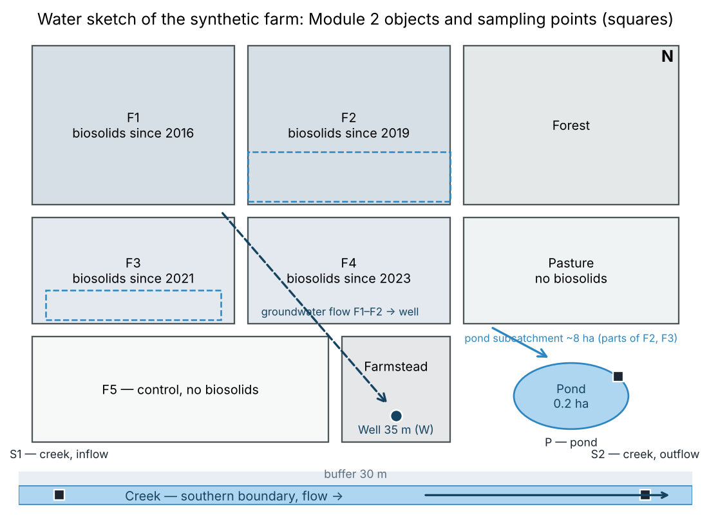
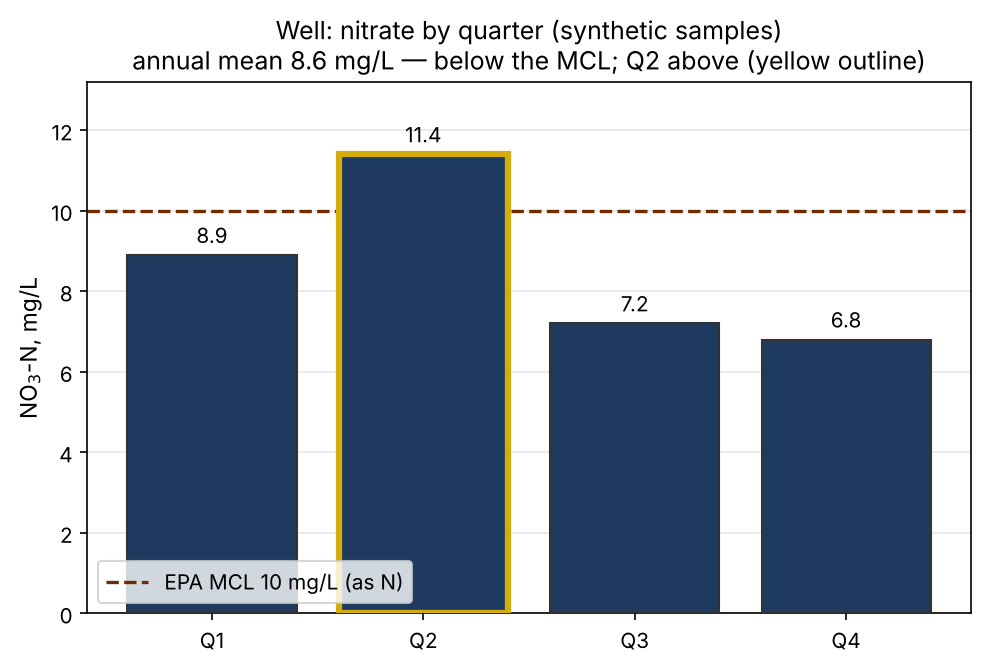
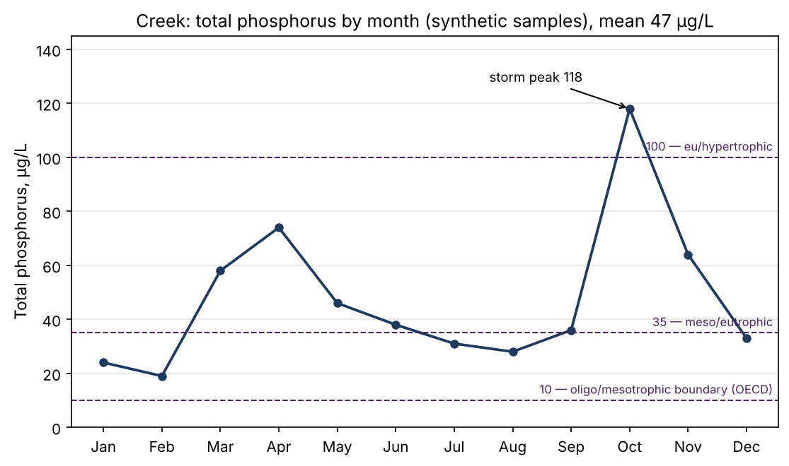
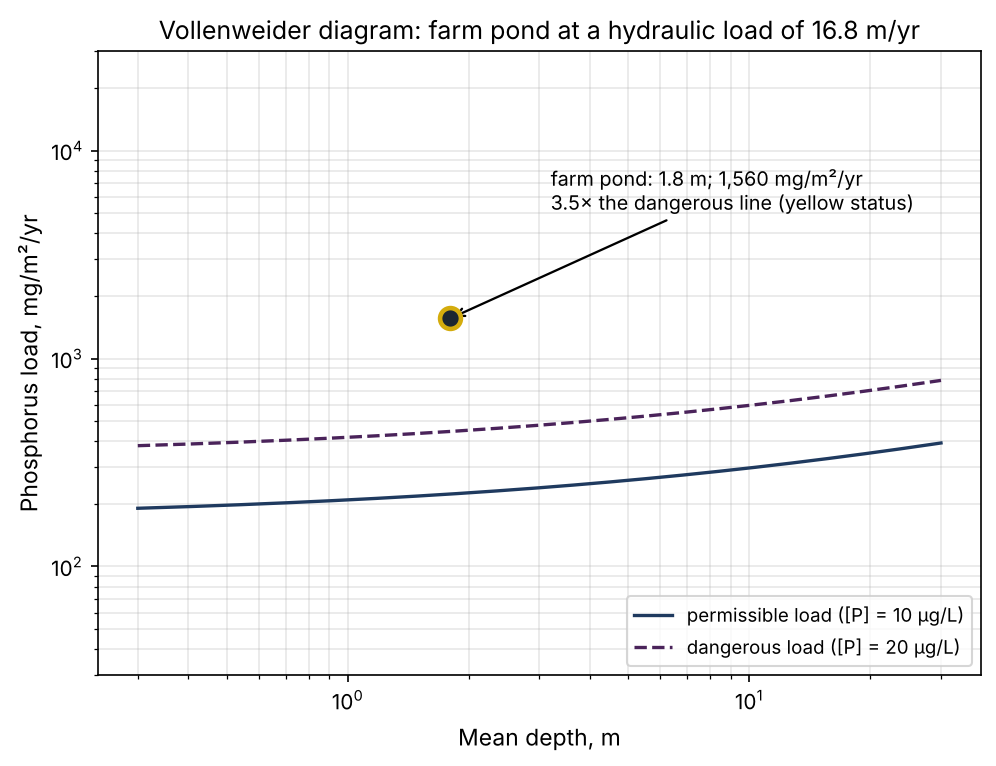
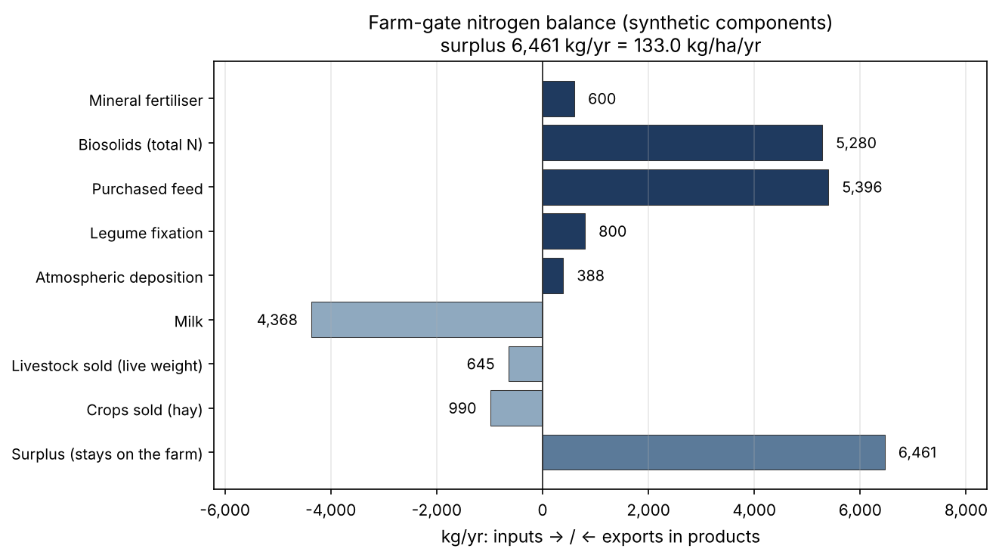
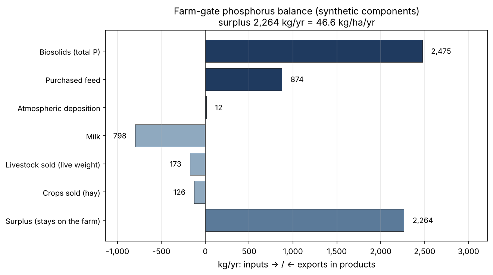

# Farm screening, Module 2: water quality and plant nutrition — a synthetic example

**SYNTHETIC EXAMPLE (simulation).** The farm is the same as in Module 1 (PFAS); its history and every laboratory value are invented and labelled as synthetic. Real: the regulatory anchors (EPA MCL, EPA recreational criteria, OECD trophic boundaries, Vollenweider loading criteria, the Cornell benchmark for farm balances), the structure of the passport and the logic of the calculation. Date: 2026-10-31. Continues FARM-PFAS-SIMULATION-2026-10-31 (Module 1).

**English edition of redaction 2 (2026-11-05).** The Russian text (`FARM-WATER-NUTRIENTS-SIMULATION-2026-10-31-r2.md`) is the source; numbers, statuses and conclusions are identical. Redaction 2 corrected the wording after the threshold check of 2026-11-01. **Synthetic values are unchanged.** The original redaction of 31 October is kept unchanged. The revision history is at the end.

## Summary
Module 2 of the same synthetic dairy farm in Delaware County, New York (Catskill/Delaware watershed), covers water and the nitrogen and phosphorus cycles. The well is yellow for nitrate: the annual mean of 8.6 mg/L is below the federal MCL of 10 mg/L, but the spring quarter (11.4 mg/L) is above it; this is a second, independent yellow signal from the same well and the same flow path from fields F1–F2 as PFAS in Module 1. The creek is yellow because of phosphorus: mean total phosphorus 47 µg/L with a storm peak of 118 µg/L; one event sample of E. coli is at the EPA statistical threshold value (410 CFU/100 mL), not above it. The farm pond is eutrophic (total phosphorus 68 µg/L, chlorophyll-a 21 µg/L), and its phosphorus load is 3.5 times the Vollenweider dangerous line; the loading model predicts 70 µg/L against a synthetic measurement of 68 — model and synthetic data agree. Farm-gate balances against the Cornell benchmark for New York dairy farms: nitrogen surplus 133 kg/ha/yr — above the upper bound of the per-hectare benchmark (117.7) but within the benchmark per unit of milk; phosphorus surplus 46.6 kg/ha/yr — 3.5 times the per-hectare upper bound (13.45) and 2.45 times per unit of milk: phosphorus is accumulating in the soils of the application fields. The main driver of both surpluses is imported biosolids and purchased feed, and the biosolids fields, at 46 % of the area, deliver 75 % of the field export of phosphorus.

## 1. Farm profile — Module 2 additions
The farm is unchanged from Module 1: 120 acres (48.6 ha) — fields F1–F4 (55 acres, forage, with biosolids), pasture (20 acres, no biosolids), field F5 (25 acres, control without biosolids), forest, farmstead and roads (20 acres); class B biosolids at 3 dry tons per acre per year (165 dry tons per year on fields F1–F4); ration 22 kg dry matter per cow per day, 60 % own forage; a 35 m well at the farmstead, groundwater flowing from F1–F2; a creek along the southern boundary with a 30 m buffer.

Module 2 additions (synthetic assumptions, labelled): herd size 80 cows (not fixed in Module 1), milk yield 10,500 kg per cow per year; a new object — a pond of 0.2 ha with a mean depth of 1.8 m that receives drainage from a subcatchment of about 8 ha of parts of fields F2 and F3. Module 2 sampling points: well (W), creek at the inflow and outflow of the property (S1, S2), pond (P).

## 2. Pathways and method
The module brings together three lines of evidence. The first is measurement: quarterly nitrate samples from the well, monthly total-phosphorus samples from the creek, seasonal means for the pond (synthetic laboratory values). The second is the farm-gate balance: all inputs of nitrogen and phosphorus across the farm boundary (fertiliser, biosolids, purchased feed, legume fixation, atmospheric deposition) against exports in products (milk, livestock sold, crops sold); the surplus stays on the farm and is distributed between soil and losses to water and air. The third is an export model: field export of nitrogen and phosphorus from export coefficients differentiated by land use (biosolids fields higher, pasture and control lower, forest lowest), with a delivery ratio of 0.15 to the watercourse; for the pond, the Vollenweider loading criteria. Statuses follow the discipline of the skill: red only for a sustained exceedance; screening is not an official compliance determination; every number carries its provenance — synthetic measurement, model or a dated regulatory anchor.

## 3. Results by medium

### 3.1. Well: nitrate (synthetic samples, quarters of the year)
NO₃-N by quarter: Q1 — 8.9; Q2 — 11.4; Q3 — 7.2; Q4 — 6.8 mg/L; annual mean 8.6 mg/L. Anchor: the federal EPA MCL for drinking water — 10 mg/L as nitrogen (40 CFR 141.62). The mean is below the MCL, but the spring quarter is above it — a pattern consistent with the flow path from fields F1–F2 (spring application and precipitation). The MCL formally applies to public water systems; for a private well this is screening, not a compliance determination. Status: **yellow** — the mean does not exceed, one quarter is above the anchor; red would require a sustained exceedance over a series of years.

### 3.2. Creek: phosphorus and event microbiology (synthetic samples)
Monthly total phosphorus ranges from 19 µg/L (February, base flow) to 118 µg/L (October, storm peak); the arithmetic mean is 47 µg/L — the eutrophic band of the OECD boundaries (oligotrophic < 10, mesotrophic 10–35, eutrophic 35–100, hypertrophic > 100 µg/L; boundaries checked against a secondary source); for a creek the OECD boundaries serve as an orientation of state, not a standard. One sample after the October storm: E. coli 410 CFU/100 mL — **equal to** the statistical threshold value (STV 410) of the current EPA 2012 recreational criteria (geometric mean 126, STV 410), not above it. The earlier value of 235 CFU/100 mL comes from the 1986 criteria and has been replaced. The creek is not a designated bathing area; the sample serves as an indicator of event export from the fields, not as a sanitary assessment. Status: **yellow** — driven by phosphorus (elevated baseline with storm peaks); the E. coli event sample is a signal to watch.

### 3.3. Pond: eutrophic state and Vollenweider load (synthetic data and model)
Seasonal means: total phosphorus 68 µg/L, chlorophyll-a 21 µg/L — both in the OECD eutrophic band and consistent with each other. Load: the 8 ha subcatchment of biosolids fields exports 20.8 kg of phosphorus per year; with a delivery ratio of 0.15 the load on the pond is 3.12 kg/yr, or 1,560 mg/m²/yr, at a hydraulic load of 16.8 m/yr and a water residence time of about 39 days. Under the Vollenweider criteria for this hydraulic load, the permissible load is 223 mg/m²/yr (boundary concentration 10 µg/L) and the dangerous load 446 mg/m²/yr (20 µg/L): the actual load is 3.5 times the dangerous and 7 times the permissible load. The same model predicts a pond phosphorus concentration of 70 µg/L against a synthetic measurement of 68 µg/L — a difference within the uncertainty of the coefficients; agreement between model and synthetic data shows that the method works but does not prove the model accurate. Status: **yellow** — eutrophic state confirmed by two indicators and the loading model; red if the pattern repeats in a second consecutive season or there are signs of oxygen depletion (see the gap registry).

## 4. Farm-gate balances and field export

Benchmark: farm-gate balances of New York dairy farms by Cornell (per hectare and per unit of milk; Cela et al. 2014, doi:10.3168/jds.2014-8467). The "per hectare" denominator in this module is the whole farm area, 48.6 ha.

### 4.1. Nitrogen (synthetic components, kg/yr)
Inputs 12,464: biosolids (total nitrogen) 5,280; purchased feed 5,396; mineral fertiliser 600; legume fixation 800; atmospheric deposition 388. Exports in products 6,003: milk 4,368; livestock sold 645; crops sold 990. Surplus — **6,461 kg/yr, or 133 kg/ha/yr**: above the upper bound of the Cornell per-hectare benchmark (117.7 kg/ha), but within the benchmark per unit of milk. The surplus is manageable: the two largest inputs (biosolids and purchased feed) make up 86 % of all inputs. The farm-gate balance counts total biosolids nitrogen; the share actually available to plants in the year of application is lower (see the gap registry). Line status: **yellow** — the surplus is high but explained and addressable through application rates.

### 4.2. Phosphorus (synthetic components, kg/yr)
Inputs 3,361: biosolids (total phosphorus) 2,475; purchased feed 874; atmospheric deposition 12; no mineral phosphorus fertiliser. Exports in products 1,097: milk 798; livestock sold 173; crops sold 126. Surplus — **2,264 kg/yr, or 46.6 kg/ha/yr**: 3.5 times the upper bound of the Cornell per-hectare benchmark (13.45 kg/ha) and 2.45 times per unit of milk. Unlike nitrogen, phosphorus hardly leaves to the air and is not denitrified, so the surplus accumulates almost entirely in the soils of the application fields — a direct consequence of applying biosolids at a nitrogen-based rather than a phosphorus-based rate. Line status: **yellow, strong** — the accumulation is also confirmed by the state of the pond (section 3.3); management measure — moving the fields with the longest history of application to a phosphorus-based rate and monitoring soil phosphorus.

### 4.3. Field export (export-coefficient model)
Gross field export: nitrogen 793 kg/yr, phosphorus 77 kg/yr. The biosolids fields (22.3 ha) deliver 534 kg of nitrogen and 58 kg of phosphorus — 67 % and 75 % of the export from 46 % of the farm area; pasture 89 and 6 kg; field F5 142 and 11 kg; forest and farmstead 28 and 2 kg. With a delivery ratio of 0.15, about 11.6 kg of phosphorus per year reaches the creek, which with the annual runoff from the farm gives a flow-weighted concentration of 53 µg/L — consistent with the arithmetic mean of the monthly series, 47 µg/L (section 3.2), within the uncertainty of the model.

## 5. Gap registry
1. Well: nitrate is represented by one annual series of four samples (synthetic); nitrite, ammonium and well microbiology were not measured.
2. Creek: flow is not measured (no gauge), so all load estimates are model-based; E. coli is one event sample, with no seasonal geometric mean.
3. Pond: phosphorus and chlorophyll are seasonal means of one season; oxygen and temperature profiles were not taken; inflow volume is calculated from precipitation, not measured.
4. Balances: nitrogen and phosphorus in biosolids come from one annual product analysis (synthetic); mineralisation of biosolids nitrogen in soil (the plant-available share) was not measured — the balance counts total nitrogen.
5. The export coefficients and the delivery ratio of 0.15 are literature ranges and a model assumption, not calibrated on this farm; the only check is agreement with the creek series and the pond concentration.
6. Soil phosphorus of the fields (degree of accumulation on F1–F5) was not measured in Module 2: the link "surplus → soil → export" remains model-based.

## 6. Sampling plan to close the key gaps
Well: continue quarterly nitrate, combining the sampling of Modules 1 and 2 into one visit; once — nitrite and microbiology. Creek: install a staff gauge and a rating curve for flow, add event samples after storms and a seasonal E. coli series (for comparison with the geometric mean of 126). Pond: monthly from May to September — total phosphorus, chlorophyll-a and an oxygen profile. Biosolids: nitrogen and phosphorus analysis for every delivery batch. Soil: Mehlich-3 phosphorus on fields F1–F5 once every three years. Farm records: feed and application logs for the annual recalculation of the balances (a repeat pass takes days — skill metric M3).

## 7. Farm passport — Module 2 (answer card)
- Well, nitrate: yellow (mean 8.6, below the MCL of 10; Q2 11.4, above). Together with Module 1, the well carries two independent yellow signals along one flow path.
- Creek: yellow for phosphorus (mean 47 µg/L, storm peak 118); E. coli 410 in one event sample — at the EPA STV of 410, not above it.
- Pond: yellow (eutrophic state; load 3.5 times the Vollenweider dangerous line; model 70 µg/L against the synthetic measurement of 68).
- Nitrogen balance: yellow (surplus 133 kg/ha/yr — above the Cornell per-hectare benchmark, within the benchmark per unit of milk; drivers — biosolids and purchased feed).
- Phosphorus balance: yellow, strong (surplus 46.6 kg/ha/yr — 3.5 times the Cornell per-hectare benchmark, 2.45 times per unit of milk; accumulation in the soils of the application fields).
- Recommendations: keep the well on quarterly monitoring under both modules; for field F1 (the longest history of application), consider a phosphorus-based biosolids rate; keep the 30 m creek buffer unploughed; take no decisions on the pond (fish, aeration) until an oxygen profile has been taken.
- Provenance of numbers: regulatory anchors — EPA (nitrate MCL, 40 CFR 141.62; E. coli recreational criteria 2012); trophic boundaries — OECD (secondary source); loading criteria — Vollenweider (calculation reproduced; primary source not opened); balance benchmark — Cornell (Cela et al. 2014); laboratory values are synthetic and labelled; export and delivery coefficients — literature ranges and model assumptions, named in the text.

## 8. Limits of the example
The simulation demonstrates the product and its logic, not the state of a real farm. Agreement between the model and synthetic "measurements" shows that the method works but does not prove the model accurate. The screening is not an official determination of compliance: the nitrate MCL applies to public water systems, and a private well is assessed as screening. The skill makes no medical determinations and does not forecast health; personal drinking-water questions are settled by laboratory analysis and consultation, not by a farm passport. Herd size (80 cows) and the pond are assumptions introduced by Module 2 and labelled in the text. State on 2026-11-06: illustration photographs are not part of the public package; figures rebuilt. Open: the OECD boundaries and the Vollenweider criteria were not checked against the primary source and carry the corresponding verification mark in the pack.

---

## Revision history (redaction 2, 2026-11-05)
| # | Where | Was | Now |
|---|---|---|---|
| 6 | Summary, §3.2, §7 | "E. coli 410 against the EPA recreational value of 235" — an event exceedance | 410 = STV 410 of the current EPA 2012 criteria (GM 126), not an exceedance; 235 is from the 1986 criteria, replaced; the creek's yellow rests on phosphorus |
| 7 | Summary, §4.1, §4.2, §7 | "Upper part of the typical range of dairy farms" | Cornell benchmark: nitrogen 133 > 117.7 kg/ha, within the benchmark per unit of milk; phosphorus 46.6 — 3.5 times 13.45 kg/ha, 2.45 times per unit of milk; denominator — the whole farm, 48.6 ha; phosphorus "yellow, strong" |
| — | §3.2, §7, §8 | — | Verification marks: OECD — secondary source; Vollenweider — primary not opened; nitrate — 40 CFR 141.62 |
| — | §3.3, §8 | — | Caveat: agreement between model and synthetic data does not prove the model accurate |

**Figures** (`figures/en/`, built by `make_figs_en.py` from the unchanged data block of `make_figs2.py`): series colours are neutral; red, yellow and green in the passport mean status only.
